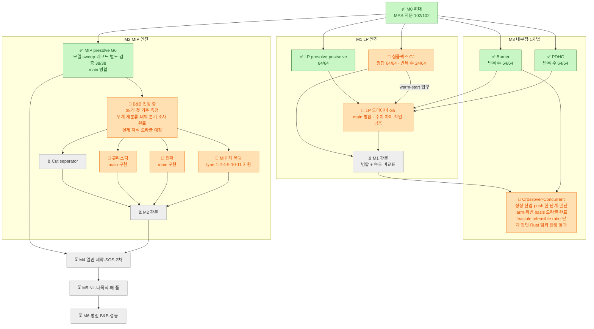

# 12. 로드맵 다이어그램

M2-03d-9 다이브 행 선택을 Rust로 이식했다(L1). `dive_rows::select`가 03d-8 캡처 입력에서 선택 2,093건의 목록·순서와 `66661c` 호출 26,278건을 원본과 정확히 재현한다. 관문·목록 유지·`bnb.rs` 연결은 남았다. M2-03d-4의 남은 선행은 M2-10b, M1 요청, 목록 유지 이식이다. [계약과 결과](m2/mip_dive_rows_rust.md).

M2-03d-8 DynamicRows 다이브 행 선택 규칙 오라클을 완료했다. `5fb8ec` 선택 블록의 입력(노드 bound, 행 플래그, cut 속성·slack, rc, cutoff)과 결과를 4사례 3회씩 캡처했고, Python 재구성(`a7cec0`·`66661c` 포팅 포함)이 선택 2,093건의 목록·순서와 `66661c` 호출 26,278건을 정확히 재현했다(탐색 sweep 38모델도 일치). DynamicRows=0 대조군은 선택 0회다. cut 플래그·`7889a5`·'=' 최소 활동값·cutoff′·cut 0x14·`+0x40` 절은 C만이다. Rust 이식은 M2-03d-4 선행(번호 미배정). [계약과 결과](m2/mip_dive_rows.md).

M2-03d-7 B&B 노드 LP 빈 행의 출처를 확인했다. 다이브 첫 노드에서 행을 비활성하고(관문은 C로 읽은 숨은 DynamicRows)(`5fb8ec`→`10e5fc`→`edd71`), 매 `cda5b` 동안 `10f448`이 D 길이·rhs를 줄인 사본과 바꾼다. 원본 3회 동일, X 목록=R, 633단계 순서 재생, 변조 22종 거부. 선택 조건은 M2-03d-8에서 대조했다.

M3-04c-2 위반 basis primal push를 오라클·Rust로 범위 한정 완료했다. 위반 LP 두 순서 각 원본 3회 19단계에서 σ 방향식 10종단·`054eef`·이탈 `B`→-1·`A`→-2를 관측했고, Rust 방향식·`infeasible_ratio`가 위반 38단계·연결 137·합성 55호출에서 비트 일치했다. `056973` 재시도와 theta=I 재호출은 M3-04c-7이다. [계약과 결과](m3/primal_push_violated.md).

M2-03d-6 일반 B&B 노드 재풀이의 노드 LP 오라클을 완료했다. 03d-5 적중 노드(nidda seed 1 노드 16948)의 LP(253×488)·basis·Cutoff·재풀이 결과(primal → 2)·노드 처리를 원본 기준 1회와 계측 3회로 캡처했다. simplex ws는 API LP에서 96행을 비운 LP이고 출처는 미확인이다. M2-03d-4 L2의 일반 노드 재생 사례가 생겼다. [계약과 결과](m2/mip_retry_bnb_node_lp.md).

M2-03d-5 일반 B&B 노드 자연 재풀이 스캔을 완료했다. 228회 고정 매트릭스에서 재시작 없는 본 탐색 노드(tier A) 재풀이는 0건, 재시작 뒤 본 탐색 노드(tier B) 1건(nidda seed 1 노드 16948, 3회 재현)이다. Rust가 같은 노드에 자연 도달할 수는 없다. 다음 제안은 이 노드의 LP 캡처(M2-03d-6)다. [계약과 결과](m2/mip_retry_bnb_scan.md).

M3-04b-3 primal push 미관측 arm 오라클을 완료했다. 시작 벡터(PStart·DStart)로 설계한 블록 대각 LP에서 거부 두 arm, pivot 보류(새 양성 훅), 고정폭·`U`·`L`(a<0) 이탈 arm, 첫 절 방향 1·방향 1 거리 flip·진입 slack을 두 순서 각 원본 3회로 관측했다. 판단 모델과 04c-6 Rust가 50단계(고유 43)를 원본과 비트 일치로 재구성했고 Rust 생존 변조는 15종에서 6종으로 줄었다. 남은 생존은 feasible 경로에서 도달 불가(`A`·`B`·`X`·기본 arm, ±0 pivot)이거나 정확 경계·재호출이다. [계약과 결과](m3/primal_push_arms_oracle.md).

M3-04c-6 primal push 단계 판단 Rust를 범위 한정으로 완료했다. 방향식·열 부호 반전·거리 flip·거부·승인·이탈 상태가 04b-1·face5 저장 캡처 40단계(고유 입력 20, 보조 frame 9단계)에서 원본과 비트 일치했다. 연결 검사로 Rust 반전 열의 `feasible_ratio`도 49단계 일치했다. Rust 변조 분류가 오라클과 같고 생존 15경계·미관측 arm은 미검증이다. push 연결·pivot 적용은 예정이다. [계약과 결과](m3/primal_push_decision_rust.md).

M2-03d-3 노드 LP 오라클을 완료했다. nidda(RINS 고정 연속부 LP, 253×464)와 gmu(sub-MIP 루트, 53×110)의 노드 LP·cutoff·env 파라미터를 원본 3회로 캡처했고, Rust용 기준 파일을 만들었다. 두 사례 모두 일반 B&B 노드가 아니라서 M2-03d-4는 LP 재생(L2)까지만 이 자료로 검증할 수 있다. [계약과 결과](m2/mip_retry_node_lp.md).

M3-04b-2 primal push 판단 오라클을 완료했다. ratio 뒤 거부·이탈 상태가 읽는 `0x1ec8`·`0x1eb0`·`0x1e88(%rsp)`는 루프 준비에서 h=`S+0x380`의 `100h`·`-100h`·`h+h`로 한 번 쓰는 상수임을 asm·CFG(`tools/push_slot_reach.py`)와 새 agent의 frame 비트로 확인했다. 판단 모델(`tools/primal_push_decision_check.py`)이 04b-1 저장 캡처 18단계와 목적 있는 `face5.lp` primal-first·dual-first 각 독립 3회(11단계, 방향 1 3건, r≠0 7건)에서 방향·alpha 반전·단계 종류·theta·이탈 상태를 원본과 같게 재구성했다. 새 agent는 frame 필드를 빼면 04b-1 사건과 같다. 방향 1 3건은 모두 r>0 절이다. 캡처·판단 변조 24종을 거부했다. 모델 변조 20종 중 판단으로 3종, r 비트로 1종을 거부했고 상수 4종은 frame 값 대조와 같은 정보다. 2h는 값만 확인했고 읽는 arm은 미관측이다. 거부 판정 발동·pivot 보류·`A`·`U`·`B`·`X`·고정폭·`L`(a<0) arm은 9개 LP 탐색에서 미관측이며 생존 12경계와 함께 M3-04b-3으로 넘긴다. Rust 판단은 위 M3-04c-6 기록을 따른다. 솔버 코드는 바꾸지 않았다. [계약과 결과](m3/primal_push_decision_oracle.md).

M3-04c feasible ratio `055f68` 첫 패스를 Rust(`crates/lp/src/crossover.rs`)로 구현했다. 04b-1 자연 캡처의 ratio 9입력(primal-first·dual-first 각 3회)과 04b 합성 29사례×3회를 저장 기준으로 재생해 위치·theta·pivot이 비트 단위로 일치했고, 합성은 work도 일치했다. 자연 호출의 xmm 인자는 asm으로 `S+0x380/0x398/0x370`임을 확인해 재구성했다. Rust 소스 변조 14종 중 10종을 거부했고, 살아남은 2차 상한 동률·후보 있는 I 상한·작은 pivot 임계값 4경계는 미검증이다. 재진입 패스는 원본에서 관측되지 않아 Rust가 거부한다. 인계 문구의 pivot·flip 판정·적용은 캡처에 없는 `0x1ec8(%rsp)`(출처 미확정)·`local_250`을 읽어 이번 경계에서 빼고 M3-04b-2로 넘겼다. Gurobi는 실행하지 않았다. Rust workspace 테스트·clippy 통과, Python 확장은 변경이 없어 미실행. [계약과 결과](m3/primal_push_ratio_rust.md).

M3-04b-1 정상 primal push 한 단계 오라클을 완료했다. `interior.lp`(8×12)에서 primal-first·dual-first를 각각 원본 독립 3회 실행해 후보·ratio·pivot·flip·교환 직후·factor 후 상태가 비트 단위로 일치했고, 각 실행에 pivot 7건·flip 2건이 있다. Crossover=0 대조군 3회는 push 0건이다. 실제 캡처 변조 15종×2를 모두 거부했다. 두 순서의 primal push 단계 순서는 같고, infeasible ratio·batch·x87·factor 내부·Rust 동등성은 미검증이다. 솔버 코드는 바꾸지 않았다. 다음은 M3-04c다. [계약과 결과](m3/primal_push_step_oracle.md).

M2-03d-2 재풀이 판단 제어를 L1로 완료했다. LP를 주입받는 `retry::process_node_lp`가 nidda 원본 LP 결과 재생에서 basis·method·노드 상태·저장 여부를 원본과 맞췄다. B&B 미연결, 실제 경로와 Rust LP 동등성은 미검증이다. 선행: M2-10b, M1 primal warm·cutoff, M2-03d-3. 이후 M2-03d-4. [계약과 결과](m2/mip_retry_control.md).

M2-03d-1 비교 경계 조사를 완료했다. 원본 재풀이 사례(nidda 비루트 464행, gmu 53×110 sub-MIP 루트 추정)는 Rust 자연 실행으로 도달할 수 없어, 03d-2는 원본 LP 결과를 주입한 재풀이 제어 재생(L1)으로 비교한다. 사건 형식과 nidda 기준 자료를 저장 캡처에서 투영했고 변조 18종을 거부했다. primal warm start·LP cutoff는 M1 선행, 노드 LP 캡처는 M2-03d-3이다. [계약과 결과](m2/mip_retry_rust_boundary.md).

M3-04b primal push 분기 조사를 완료했다. double·x87 경로와 후보·ratio·이동·basis·재분해·반환 경계를 원본 C·ELF로 특정했다. `055f68` 원본 합성 29사례×독립 3회와 CLI 변조 10개 검사가 통과했다. [조사와 검증](m3/primal_push_branches.md). 전체 push 자연 실행과 Rust 동등성은 미검증이며 다음은 M3-04b-1 정상 push 한 단계 오라클이다.

M3-04a-1 정상 crossover 진입 오라클을 완료했다. 소형 LP 하나에서 PDHG·barrier mode 0과 시작 벡터 mode 1을 각각 원본 독립 3회 실행했고 경로별 상태·배열이 비트 단위로 일치했다. 검토자도 세 경로를 각 1회 재캡처해 일치시켰다. Crossover=0 대조군은 목표 0건×3회, 실제 캡처 오류 주입 7개와 추가 변조 검토·합성 self-test도 통과했다. 원본 분기에 따라 warm 설정을 Method=1에서 2로 바꿨으며 기존 실패 3개는 보존했다. [계약·원본 근거·실행 결과](m3/crossover_entry_oracle.md). Rust·시간·work·다른 모델 동등성은 미검증이다. 후속 primal push 조사는 맨 위 M3-04b 기록을 따른다.

M3-04a 정적 조사를 완료했다. PDHG·barrier·시작 벡터의 crossover 진입, 배열 순서·변환·할당 실패·환경 복원과 cleanup 내부 상태 배열 설치 경계를 원본 C·ELF로 확인했다. 정적 조사만으로 Rust 동등성을 판정하지 않는다. [조사 기록](m3/crossover_entry_contract.md). 후속 원본 오라클 결과는 위 M3-04a-1 기록을 따른다.

M2-03c-2 재풀이 basis 오라클을 완료했다. 입력 basis는 노드에 저장된 시작 basis다(export→복사→압축→decode, 첫 LP와 같음). 재풀이 뒤 원본 VBasis export는 nidda에서 없고 gmu에서는 `5d4427`이 만든다. 재풀이는 workspace 상태를 되돌리고 노드 basis를 다시 적재·분해하며 dual norm 입력은 없다. 원본 12회와 변조 17종 검사가 통과했다. LU·가중치 내용과 Rust 동등성은 미검증이다. 다음은 M2-03d-1(비교 경계)과 M2-03d-2(구현)다. [계약과 결과](m2/mip_retry_basis.md).

M2-03c-1은 **부분 완료**다(main 병합). 사용자 결정으로 계약을 바꿨다. Gurobi 원본에서 자연 상태 12 재풀이 2건(비루트·루트)의 입출력·파라미터 복구·basis 입력/header, 합성 5→12 재분류, 상태 3 호출자 `682037`을 각 3회 검증했다. 병합 전 원본 33회 재실행에서 비교 30건이 모두 일치했다. 재풀이 후 VBasis·입력 basis 출처·factor/norm은 M2-03c-2로 분리했다. 상태 10·자연 5→12(정상 산술에서 불가능, 미관측)는 미검증이다. Rust는 변경하지 않았고 동등성은 미검증이다. 상세는 [M2-03c-1](m2/mip_linear_child_trace.md) §10–13.

상태: ✅ 완료 · 🔄 진행 · 🔎 에이전트 검증 완료·병합 대기 · ⏳ 예정 (2026-11-10 기준. main에 병합된 구현과 남은 작업을 표시한다. 세부 기록은 [11_progress.md](11_progress.md), 심플렉스 최신 검증은 [10_porting.md §9.2](10_porting.md))

M1·M2·M3의 세부 작업 번호, 상태와 확인 방법은 [작업 단위 목록](13_work_units.md)에 있다. G1~G6은 기존 검증 관문이다.

M2-03b-1 선형 경로 조사를 완료했다. 루트 캐시 2의 LP 상태 5→12 재분류·즉시 재풀이와 상태 3의 대체 분기 소비를 확인했다. 같은 노드 재등록은 7·8·10이며 대체 분기가 상태 10인 새 자식을 만들 수 있다. 원본 합성 setter·게이트·분기 자격 156회와 오류 주입 4개를 확인했다. 실제 자식 연결·Rust 동등성은 미검증이며 솔버 코드는 유지했다. 다음은 M2-03c-1 선형 호출자·대체 분기 오라클이다. [계약과 결과](m2/mip_unbounded_reclassification.md).

M2-03a 직접 진입 조건 조사는 완료했고 main `ebb35d6`에 병합했다. 순수 선형 LP 무계 입력의 노드 보류와 루트 호출자의 별도 무계 확정을 구분했고, 호출 없는 원본 합성 상태 13개×3회를 확인했다. 직접 상태 11·ray·실제 자식 연결과 Rust 동등성은 미검증이다. 후속 M2-03b-1 결과는 위 기록을 따른다. [상세 결과](m2/mip_unbounded_entry.md).

스프린트 구현 완료는 [동작 동등성 검증 기준](15_sprint_verification.md)의 원본 구간 계약으로 판정한다. 시간·집계 결과만으로 내부 동작 일치를 판정하지 않으며 작업 수행 완료·동등성 판정·전체 관문을 구분한다. 기준 문서와 계약 양식, 시작 지침은 main에 커밋됐다.

24개 번호는 상위 작업이며 실행할 항목은 [1주 스프린트 하위 작업](14_sprint_plan.md)에서 선택한다. 원본 미해독 영역은 조사로 설계를 확정한 뒤 구현 작업을 추가한다. 다음 착수 후보는 M2-03c-1이다. 이 계획과 영역별 설계 보완은 main에 커밋됐다.

새 세션은 [인수인계 안내](handoff/README.md)와 영역별 다음 작업을 읽는다. 같은 저장소의 세 영역 점유와 오프라인 컴퓨터 이동 도구를 추가했다. 컴퓨터 간 자동 동기화는 아직 없고 기존 원격 금지 정책을 유지한다. 설정과 인수인계 문서는 main에 커밋됐다. 브랜치·병합 운영은 [운영 스킬](../.agents/skills/verified-task-branches/SKILL.md)을 따른다.

운영 상태: 기존 선행 변경을 네 커밋으로 분리해 main `09dc65f`에 병합했고, M2-03a는 새 기준선에 재적용해 별도 병합했다. 기존 코드는 스냅숏과 동일하며 Rust 113개·Clippy·Python 653개·세션 도구 3개와 복원 오라클이 통과했다. 운영 스킬·현재 기록은 별도 작업 branch에서 병합하며 종료 시 main만 남긴다. 원래 dirty 상태와 스냅숏 이력은 safety ref로 보존한다. [정리와 검증](m2/baseline_reconciliation.md).

## 현재 작업 범위

- 상세 작업 기록은 `docs/m1/`, `docs/m2/`, `docs/m3/`로 정리했으며 [문서 안내](README.md)에서 찾을 수 있다. 기존 선행 작업은 main에 커밋됐다.

- 현재 MIP 후속은 M2-03 자식 LP 무계, M2-04 시간 제한, M2-05 해 복원으로 구분한다. [작업 단위 목록](13_work_units.md)은 main에 커밋됐다.

- 자식 LP 무계의 직접 확정 조건·필드·호출표를 M2-03a에서 확정했다. 선형 입력은 노드 상태 3으로 보류되고 루트 무계는 호출자가 별도 처리한다. 호출 없는 원본 합성 상태 13개×3회를 확인했으며 ray·직접 상태 11·실제 자식 연결은 실행 미검증이다. Numeric 처리는 유지한다. [조사 기록](m2/mip_unbounded_entry.md)은 main에 병합됐다.

- `AGENTS.md`에 원본 복원 기준과 프로젝트 탐색·검증 경로를 정리했고 main에 커밋했다. 브랜치·병합 스킬을 필수 참조한다.
- B&B, 루트 전파·휴리스틱과 Python MIP 풀이가 main에 있다. presolve 연결과 고정·치환 해 복원은 `13ce2fe`에 커밋됐고 `3e5c9d4`로 main에 병합됐다. 진행 문서도 main에 커밋됐다.
- type 4 flag 1·2와 type 10·11, 빈 축약 모델 처리를 추가했다. type 4 정수 분기는 합성 원본 오라클 1,000개와 일치하고 mas74·mas76 원본 해 검사를 통과했다. 빈 축약 enlight_hard는 최적해 37을 복원했다. type 10·11 대상 두 모델은 Gurobi가 축약 모델에서 구한 해를 원본 공간으로 복원해 검사했다. rsolver는 두 모델에서 30초 내 해를 찾지 못했다. 38개 재측정은 전부 축약 경로, 최적 1·시간 초과 37, 원본 해 검사 22개 통과다. 그 외 미지원 레코드와 복원 검증 실패 시 원본 모델로 우회한다. [작업 기록](m2/mip_recovery_bnb.md). 변경은 main에 커밋·병합됐으며 기존 검증 한계는 유지한다.
- G6의 모델·레코드·PRELIMIT 저장 변화점 및 최종 모델 38/38을 2026-11-09 별도 검증했다. 38개에서 실행되지 않은 하위 풀이는 미구현이며 `3e5c9d4`로 main에 병합됐다. 범위는 [m2_presolve.md](m2/m2_presolve.md)에 있다.

- MIPLIB 38개 첫 측정에서 rsolver 37개 시간 초과, 1개 외부 감시 중단이었다. 이 기준은 시간 제한·복원 경로 후속 전의 저장 결과다. 결과와 도구는 main에 커밋됐다: [기준표](m2/mip_bnb_baseline.md).

- 5초 재측정에서 rsolver 38개가 시간 제한으로 반환됐고, 실제 경로는 축약 26·미지원 레코드 우회 12였다. simplex 반복 시간 제한을 추가했으며 presolve 내부 중단은 남았다. 이 측정은 type 9 지원 전의 저장 결과다. [결과](m2/mip_bnb_5s.md)는 main에 커밋됐다.
