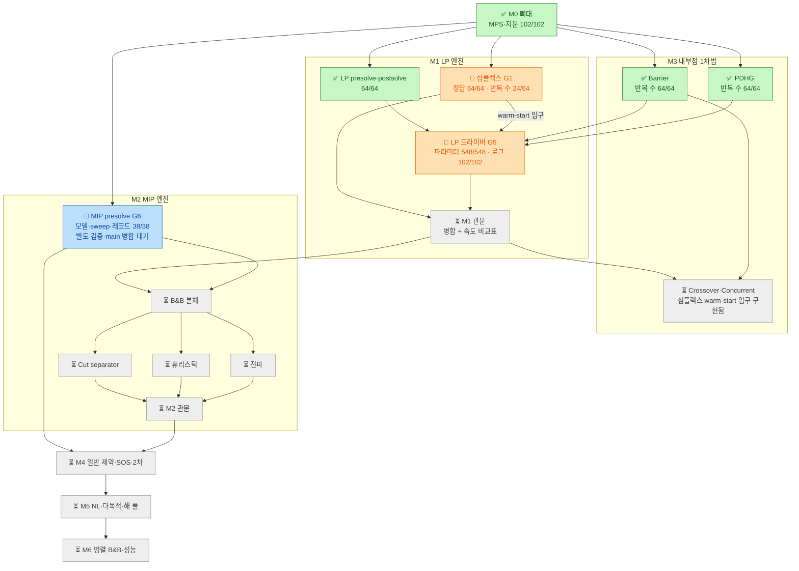

# 12. 로드맵 다이어그램

상태: ✅ 완료 · 🔄 진행 · 🔎 에이전트 검증 완료·병합 대기 · ⏳ 예정 (2026-11-06 기준. 세부 기록은 [11_progress.md](11_progress.md), 심플렉스 최신 검증은 [10_porting.md §9.2](10_porting.md))

## 병렬 구간

- 지금: 심플렉스와 LP 드라이버는 진행 중이다. MIP presolve는 에이전트 검증을 마쳤고, 별도 검증과 main 병합을 기다린다.
- M1 관문 뒤: Crossover·Concurrent와 B&B 본체를 함께 시작한다.
- B&B 골격 뒤: Cut, 휴리스틱, 전파를 각자 다른 탭에서 진행한다.
- MIP presolve 검증·병합 뒤: M4 일반 제약 변환은 B&B와 겹쳐 진행할 수 있다.

G6의 38/38은 `m2-mip-presolve`의 `2f28f77`에서 에이전트가 보고한 결과다. 미검증 경로와 미구현 처리의 한계는 [11_progress.md §3](11_progress.md#3-완료-기록)에 기록했다.
