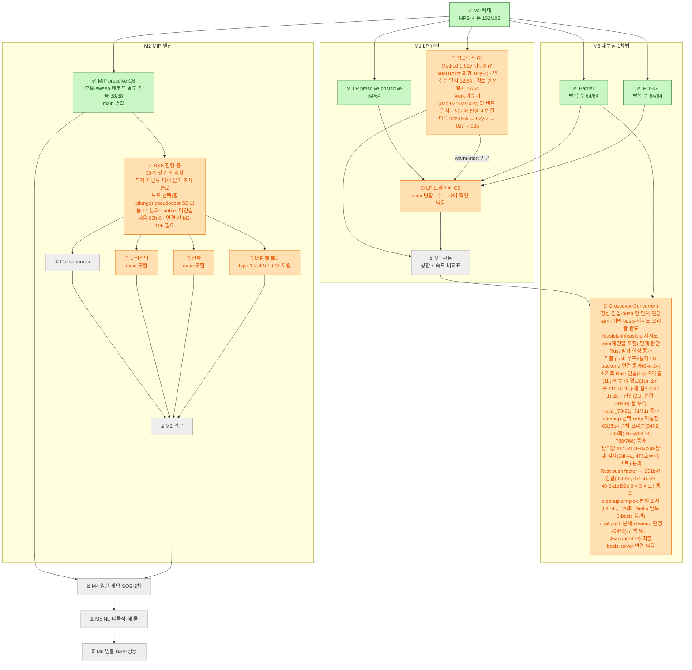

# 12. 로드맵 다이어그램

<!-- progress:begin -->

<!-- progress:end -->

최근 작업의 상세 문단은 [11_progress.md](11_progress.md) 맨 위에 있다. 11과 바이트 단위로 같던 문단 38개는 2026-11-13에 이 문서에서 뺐고, 아래에는 11보다 짧은 요약 문단과 안내만 남겼다. 새 작업의 요약은 `docs/progress/<작업번호>.md`의 `## 12` 구역에서 위 블록으로 생성된다(형식은 [작업별 진행 파일](progress/README.md), 생성은 `tools/progress_index.py`).

M3-04c-13 공급자 원본 오라클을 완료했다(범위 한정). 자연51공급·합성18경계를 독립3회 재현하고 후보·보류·통계·FTRAN 입출력/별칭·압축을 대조했다. 내부 raw dense9회는 interior에서 실제 관측됐으며 sparse 반환만으로 경로를 추정하지 않는다. 변조31종·독립 검토 추가7종 거부, 자연/합성 재캡처 일치, 기존 Rust236단계 회귀 통과. 다음은 **M3-04c-14**(외부 FTRAN backend를 쓰는 공급자 제어 L1)다. 실제 LU 연결21·루프 연결22·batch23과 전체 crossover는 남아 있다. [계약과 결과](m3/primal_push_supplier_oracle.md).

M3-04c-12 push 루프 본체 분할 조사를 완료했다(구현 동등성 미검증). 후속은 공급자13→14·factor제어15→16·재계산17→18·라운드19→20(각 오라클→L1 구현), 수치 LU 연결 조사21·초기화된 제어 연결22·batch 조사23이다. 기존 자연18기록을 재검사·집계했고 Rust 연쇄236단계·필드5,144 비트 일치를 다시 확인했다. 새 원본 실행0, 수치 backend와 전체 push는 미연결이다. 다음은 **M3-04c-13** 또는 dual push(M3-04d)다. [상태·근거·후속 계약](m3/primal_push_loop.md).

M3-04c-11 push 한 단계 연쇄의 생존 경계(lb≠0·위반 해소·자유 열 flip·F 행 루프)를 원본 캡처로 확인해 Rust 변이 거부를 15→21로 늘렸다(Rust 변경 없음, 236단계 비트 일치). Frida는 프리로드 해석으로 이 컴퓨터에서도 돈다. 남은 것은 push 루프 본체(M3-04c-12)와 dual push(M3-04d)다. [계약과 결과](m3/primal_push_chain_oracle.md).

M3-04c-10 primal push 한 단계의 선택·적용을 Rust `push_pick`·`push_apply`로 연결해 범위 한정 완료했다. 자연 캡처 166단계를 연쇄 재생해 비트 일치했다. 남은 것은 lb≠0·위반 해소 원본 캡처(M3-04c-11, Frida 필요), push 루프 본체(공급자·factor 갱신 판단·재분해, M3-04c-12)와 dual push(M3-04d)다. [계약과 결과](m3/primal_push_step_chain.md).

M3-04c-9 `054eef`·`056973` 작은 pivot 재진입을 원본 합성 3회(231사례, 바이트 동일)와 Rust 재생으로 범위 한정 완료했다. 세 ratio(`055f68`·`054eef`·`056973`) 모두 재진입을 원본대로 돌고 Rust의 `Reentry` 거부가 없어졌다. 남은 것은 push 루프 연결과 dual push(M3-04d)다. [계약과 결과](m3/primal_push_violated_reentry.md).

M3-04c-5 `055f68` 작은 pivot 재진입과 `12dd49` 요청 2를 원본 합성 3회(91사례, 바이트 동일)와 Rust 재생으로 범위 한정 완료했다. 04c에서 생존한 2차 상한 동률·후보 있는 상한 I·0.1·계수표 변이를 모두 거부하게 됐다. 남은 것은 push 루프에서 요청 2 적용과 `054eef`·`056973` 재진입 Rust다.

M2-06g-2 SB 후보 분할·결과 소비·부분 상태 복구·반복 비용 계약을 원본 캡처로 확인했다(조사·오라클). 6사례 × 3회, 후보 분할 1,754·SB 149묶음·방향 복사 742가 규칙 재생과 같다. `691453`의 기존 “후보 평가” 설명을 부모 LP 확인으로 바로잡았다. 전체 factor 복구·오류·병렬은 미검증이다. 다음은 M2-06h-1(저장·복구 오라클) → 06h-2(후보 하나 L1 제어). [기록](m2/mip_sb_restore.md).

M1-02s `05b257` 뒤 처리 work 13지점(`1bae9c`·`1b7106`·`1ca57`·`16b0a`)을 옮겼다(구현, 통과). 재분해 진입 work를 원본 값으로 주면 kb2·degen2 피벗 0–355에서 분해·갱신·뒤 처리 저장 4,625개가 원본과 비트까지 같다. 반복 커널은 M1-02v로 나눴다. work는 아직 재분해 판정에 연결하지 않았고 Netlib 경로는 그대로다. 남은 묶음은 M1-02v(반복 커널)·02t(LU 풀이)·02u(`48d5f`·`8b473` 분기). [계약과 결과](m1/m1_02s_post_work.md).

M2-06g pseudocost 읽는 쪽 식(`6ef12f`·`6eed2e`)·SB 캐시(`6ee5d1`)·η 수명을 원본 캡처로 확정했다(조사·오라클). 6사례 101만여 호출이 비트·정확 일치한다. SB 풀이 결과 소비·복원표·후보 목록은 M2-06g-2로 나눴고 06h의 선행이 됐다. Rust·`bnb.rs` 미연결.

M1-02r FT 갱신 `05b257`의 work 저장 15지점과 재분해 경로 spike 지우기(0xf461f)를 옮겼다(구현, 통과). 재분해 진입 work를 원본 값으로 주면 kb2 전 구간·degen2 피벗 0–355에서 분해·갱신·재분해 뒤 저장 3,606개가 원본과 비트까지 같다. work는 아직 재분해 판정에 연결하지 않았고 Netlib 경로는 그대로다. 남은 묶음은 M1-02s(반복 커널·`1ca57`·`16b0a`)·02t(LU 풀이)·02u(`48d5f`·`8b473` 분기). [계약과 결과](m1/m1_02r_ft_work.md).

M2-06e-2 pseudocost 표 B 갱신과 표 C 용도를 원본 캡처로 확정했다(조사·오라클). 표 B는 노드 LP 최적 뒤 bound에 있는 비기저 정수 열의 환산비용을 방향별 5회까지 모으는 표이고, 6사례 18,774회 갱신과 work가 규칙 재생과 비트까지 같다. 표 C는 probing 결과(정수 Δ·2e9)를 모으는 표로 신뢰성 판정과 이득 추정이 읽는다. 다음은 M2-06g(SB 입력, 표 B를 읽는 `62f909` 포함), `bnb.rs` 연결 준비. [계약과 결과](m2/mip_pseudocost_bc.md).

M1-02q dual work 계수기를 Rust에 두고 분해(`036ade`)·재분해 뒤(`05b257`·`9e60b`)·시작 지점을 옮겼다(구현, 통과). 재분해 진입 work를 원본 값으로 주면 kb2 5회·degen2 피벗 0–355의 재분해 9회에서 저장 147회·spx+0x158·Markowitz 누적 항이 원본과 비트까지 같다. work는 아직 재분해 판정에 연결하지 않았고 Netlib 경로는 그대로다. 다음은 M1-02r(FT 갱신 지점)·02s(반복 커널·`1ca57`)·02t·02u. [계약과 결과](m1/m1_02q_work.md).

M2-06d-3 Rust plunge 선택에 규칙 4·7·9를 더했다(구현 L1, 통과). 06c-3 7사례 13,830호출의 선택·본문 조상 질의 순서·RNG·work·꼬리가 원본 캡처와 같고, 06d에서 원본 선택을 빌려 쓰던 402호출이 0이 됐다. 판별되지 않은 절(규칙 4 나눗수 등)은 asm대로 옮겼다. 다음은 `bnb.rs` 연결 준비(`(*W)+0x60`·k 갱신), M2-06e-2, M2-06g. [계약과 결과](m2/mip_plunge_r47_rust.md).

M2-06c-3 plunge 규칙 4·7·9 점수, 규칙 1·6 본문의 조상 질의, 규칙 5 뒤 RNG를 새 캡처 재생으로 확정했다(조사·오라클). 06c 도구에 사건만 더한 새 도구로 7사례(06c 5 + BranchDir ±1)를 3회씩 잡았고, 새 사건을 뺀 투영은 기존 자료와 같다. 규칙 4 347·7 38·9 3,966호출의 선택, 본문 질의 28,245개의 순서, 06c-2 재생 불가 34호출을 포함한 규칙 1·6 전체 선택이 원본과 같다. 다음은 M2-06d-3(Rust `pick`에 4·7·9 추가). [계약과 결과](m2/mip_plunge_r47.md).

M1-02p dual work 누적의 출처를 원본 캡처로 확정했다(조사·오라클, 완료). work 쓰기는 20함수 69지점이고, 재분해 work 조건의 필드(0x150 분해 시작 work, 0x158 분해 증분 평균, 0x3d0 nnz(A))는 재분해 21회에서 비트까지 같다. 판정은 분해 구간 work 합 전체를 쓰므로 열 묶음(분해·재분해 뒤 정리·FT 갱신·반복 커널·`05b257` 뒤 처리의 피벗마다·목록 재구성·재분해 뒤 부분·LU 풀이·분기 합·모델 상수)을 모두 옮겨야 degen2 피벗 356 재분해를 재현한다. 다음은 M1-02q(work 틀과 분해 지점). [계약과 결과](m1/m1_02p_work.md).

M1-02n FT 갱신의 접두 경계와 재분해 판정을 원본 캡처로 확정하고 접두 경계를 고쳤다(조사·구현, 통과). Rust가 행 r을 U 열에서 지우는 일(LU+0xe8 올림)을 접두 판정 앞에 해서 피벗 313·326 뒤 t가 1 컸다. 순서를 원본대로 두자 degen2 피벗 0–355·kb2 0–37의 FTRAN 시점 접두 상태가 원본과 같고 02m 제외 7피벗이 없어졌다. degen2 경로 첫 차이 357은 재분해 판정의 work 조건(갱신 % 10 = 9에서 분해 이후 work 비교)이라 simplex work가 필요하다. Netlib 결과·경로 첫 차이는 기준선과 같다. 다음은 M1-02p(dual work 누적). [계약과 결과](m1/m1_02n_update.md).

M2-06d plunge 선택(규칙 번호·RNG·규칙 1·2·3·5·6·12·꼬리)을 Rust `plunge`로 옮겼다(구현 L1, 통과). 06c 5사례 9,864호출의 시드·규칙·선택·work·꼬리 처리가 원본 캡처와 비트까지 같고, 변이 17종이 06c·06c-2 변종과 같은 사례에서 거부된다. 규칙 4·7 점수와 `bnb.rs` 연결은 남았다. 다음은 M2-06c-3(규칙 4·7). [계약과 결과](m2/mip_plunge_rust.md).

M1-02m 희소 U 커널의 접두 행 순서를 원본대로 만들었다(조사·구현, 통과). 커널 경로 네 개 중 H2만 "구간 2"(처음 닿은 순)이고 그 순서는 U 열 저장 순서([꼬리 | 접두])에 달려 있어 `05b257`의 열 유지 규칙과 분해 직후 순서를 옮겼다. degen2 희소 U 231/238피벗(제외 7은 접두 길이 t 차이, M1-02n)·kb2 7/7에서 U 열 상태·커널 출력·입력 순서가 원본과 같다. Netlib 결과·경로는 기준선과 같다(degen2 첫 차이 357은 재분해 판정). 다음은 M1-02n(피벗 313 갱신 뒤 t·LU+0xec, 피벗 356 재분해 판정), M1-02o(τ 값).

M2-06c-2 plunge 규칙 1·2·5·6의 선택 점수를 06c 캡처 재생으로 확정했다(조사). 규칙 1·6은 첫 최심 항목의 조부모와 조상이 같은 형제만 보고(6은 최소 est, 1은 얕은 쪽), 2는 최소 est, 5는 정수 난수 mod n이다. 선택 7,465호출과 모든 규칙의 work 9,864호출이 비트까지 같다. 다음은 M2-06d(Rust 이식)와 M2-06c-3(규칙 4·7, 새 캡처). [계약과 결과](m2/mip_plunge_score.md).

M1-02j degen2 경로 첫 차이 288을 희소 L 커널 `21b9de` 출력 순서로 특정하고 고쳤다(조사·구현, 통과). 288은 정확한 동률이라 mode 1 목록 순서가 갈랐고, 그 순서는 α_q 목록의 빈 U 행 순서 = L 커널 출력 순서다. 원본은 L 레벨이 있으면 레벨 버킷, 없으면 Kahn FIFO로 푼다(캡처 비트 일치). Rust가 같은 커널과 R 단계 목록을 쓰게 바꿔 degen2 피벗 0–355의 α_q 순서 관련 상태가 원본과 같고, pathcmp 완전 일치 27/64·중앙 첫 차이 비율 0.752. 다음은 희소 U 접두 행 순서(M1-02m), 목록 이탈 순서·재분해 판정(M1-02n), τ 값(M1-02o). [계약과 결과](m1/m1_02j_lsolve.md).

M2-06c plunge 규칙 선택·규칙 3/12 점수·꼬리 정리 유지 판정(`6e8eb3`)을 원본 캡처 재생으로 확정했다(조사·오라클). 5사례 9,864호출의 규칙 번호·난수·선택·꼬리 판정이 비트까지 같다. 규칙은 힙 pop 누계 k로 정해지고, 꼬리는 깊이 d′ 조상이 같고 bound ≤ 문턱인 형제만 남긴다. 다음은 M2-06c-2(규칙 1·2·6 점수)와 M2-06d(Rust 이식). [계약과 결과](m2/mip_plunge_rule.md).

M1-02l kb2 피벗 30 spike 끝자리를 행 eta 내적의 정렬 선처리로 특정하고 고쳤다(조사·구현, 통과). 원본은 eta 값 배열이 8바이트 정렬이면 1개를 먼저 더하고 9개 미만이면 순차로 더한다. 정렬은 U와 함께 쓰는 LU 풀의 오프셋 패리티이고, 그 오프셋(분해 직후 2·nnz(L+U), 갱신마다 eta·새 U 열·U 행 재배치만큼 증가)을 캡처로 확정해 Rust에 옮겼다. kb2 β·LU+0x160이 피벗 0–37 전부 원본과 같고, Netlib IterCount 일치 32/64, 경로 완전 일치 26/64. 다음은 M1-02j(degen2)·M1-02k(BTRAN Uᵀ 희소 판정)·M1-02c. [계약과 결과](m1/m1_02l_eta_peel.md).

M2-06f-5 infeasible ray 수정 `6684cd`(조상 사슬의 bound 변경 기록으로 행을 더해 ray 칸을 지우고 `95ce25`로 재정규화)를 원본 캡처 재생으로 확정했다(조사·오라클). 6사례 115호출이 비트까지 같고, 미호출 92회는 휴리스틱 LP 3종과 sub-MIP 종료 검사로 모두 분류됐다. `bnb.rs` 연결에는 노드의 bound 변경 기록·cut 행 나이와 M1 경계(infeasible 행의 tableau 행)가 더 필요하다. [계약과 결과](m2/mip_infeas_ray_fix.md).

M1-02i kb2 반복 23 d·w 끝자리 차이를 BTRAN 행 eta 단계로 특정하고 고쳤다(조사·구현, 통과). 원본은 eta가 많은 쪽(`m < 0x104·nnz`)에서 `|v| ≤ ZERO`인 eta를 건너뛰고, Rust는 0만 건너뛰었다. 고친 뒤 kb2 ρ·β 피벗 0–30과 statecmp 0–30이 원본과 같다. 피벗 31 이후는 피벗 30 갱신의 spike 끝자리(M1-02l). [계약과 결과](m1/m1_02i_eta.md).

M2-06f-4 infeasible 노드 벡터 `95da98`(이탈 행의 Farkas 행)을 원본 캡처 재생으로 확정했다(조사·오라클). 6사례 131호출의 출력이 비트까지 같다. 감쇠 117회 중 45회는 `6684cd`가 고친 칸을 읽으므로 `bnb.rs` 연결에는 06f-5와 M1 경계(infeasible 행의 tableau 행)가 더 필요하다. [계약과 결과](m2/mip_infeas_ray.md).

M2-06f-3 노드 수명 모형(`5ff358`·`5f9d4e`→`5fa560`)을 Rust `NodeLife`로 옮겼다(구현 L1, 통과). 06f-2 6사례의 해제 연쇄·`5fa560` 열·감쇠 조상 열이 캡처와 같고 변이 W1·W3–W6이 거부된다. `bnb.rs` 연결은 처리 순서(06c·06d)와 감쇠 벡터(M1 경계, 06f-4) 뒤다. [계약과 결과](m2/mip_node_life_rust.md).

M1-02h Rust α_q 목록 순서를 원본대로 만들었다(구현, 통과). `09d112` 경로 조건(L·R·U 단계)과 원본 접두 행 목록 LU+0xf0(`05b257` 유지 규칙)을 옮겨 kb2 피벗 0–37 U 경로 38/38·목록·순서가 원본과 같고 statecmp 반복 0–22가 같다. 희소 L·R 출력 순서는 근사(M1-02j). Netlib IterCount 일치 30/64, 경로 완전 일치 24/64. 다음은 M1-02i(반복 23 d·w 끝자리)·M1-02j·M1-02k(BTRAN Uᵀ 희소 판정)·M1-02c. [계약과 결과](m1/m1_02h_aq_order.md).

M2-06f-2 조상 노드 정보 수명과 감쇠 벡터를 원본 캡처로 확정했다(조사·오라클). 조상 I는 자식이 모두 단계 5를 벗어날 때 지워지므로 감쇠 범위는 형제 처리 순서·힙 이동이 정한다. 6사례의 해제 연쇄와 감쇠 조상 열 7,404회가 모형 재생과 같고, 벡터 출처(최적 `12ef7f` 환산비용, cutoff, `95da98`)가 7,400회 확인됐다. Rust B&B 연결에는 수명 모형(06f-3), LP 환산비용·cutoff 상태(M1 경계), `95da98`(06f-4)이 필요하다. [계약과 결과](m2/mip_node_life.md).

M1-02g kb2 반복 22 가격 목록 순서 차이를 특정했다(조사). mode 1 갱신(`1bae9c`)은 새 위치를 α_q 목록 순서로 붙이는데, 그 순서는 `09d112` 희소 U 경로에서 위치순이 아니다(꼬리 U 위치 내림차순 + 접두 LU+0xf8 순). Rust는 위치순이라 피벗 21(희소 U 경로가 mode 1에서 처음 나온 피벗)부터 갈린다. 원본 스냅숏 재생 22피벗 일치, 원본 순서를 주입하면 반복 22 일치. 다음은 M1-02h(Rust FTRAN 출력 순서)·M1-02i(반복 23 d·w 끝자리)·M1-02c. [계약과 결과](m1/m1_02g_list_order.md).

M2-06f pseudocost 표 A를 Rust `Pseudocost`로 이식했다(구현 L1, 통과). 06e 6사례의 입구·감쇠 판정, 노드 갱신 11,157회의 w·결과, 감쇠 8,972·대칭 4·표 A 212개의 새 표·해제 스냅숏이 원본과 비트까지 같고, 변이 16종이 사전 고정 기대대로다. `bnb.rs`에는 아직 연결하지 않았다. 다음은 M2-06f-2(조상 정보 수명·LP 벡터 의미)·06c·06e-2. [계약과 결과](m2/mip_pseudocost_rust.md).

M1-02f BFRT 재훑기·NONDEGENFLIP을 Rust에 넣었다(구현, 상태 일부 미충족). 02e 코퍼스 3112호출에서 Rust `bfrt` 진입 3108·flip 3112가 원본과 같고, 켜짐 반복 6모델 일치, kb2 피벗 경로 38/38 일치, Netlib 경로 완전 일치 18 → 23/64. kb2 반복 22 가격 목록 순서는 다르다(원인은 M1-02g에서 특정). Netlib Method=1 정답 90/91, IterCount 일치 24/64 → 29/64. [계약과 결과](m1/m1_02f_bfrt_rust.md).

M2-06e pseudocost 초기화·노드 갱신·감쇠·대칭 전파를 원본 캡처로 확정했다(조사·오라클). 노드 갱신(`5fb8ec`→`6edfcf`, 깊이 가중 w)·조상 감쇠(`6ee1d3`)·루트 끝 대칭 orbit 전파(`6ef22e`, watchpoint로 발견)·M 재생성 때의 시드 초기화가 6사례×3회의 표 A 전이를 비트까지 재현하고 해제 직전 스냅숏으로 사슬이 닫힌다. 연속 변수 분기·병렬·SB 입력은 미검증. 다음은 M2-06f(Rust 이식)·06c·06e-2. [계약과 결과](m2/mip_pseudocost.md).

M1-02e kb2 피벗 21 진입 차이의 원인을 특정했다(조사). 원본 BFRT는 NONDEGENFLIP(`spx+0x3fc`, 재분해 직후 조건부로 켜짐)이 켜지면 진입을 고른 뒤 flip 구간을 다시 훑어 |α|/w′가 더 큰 flip 후보로 바꾼다. 수정 프로토타입이 Netlib 64 코퍼스에서 flip 3112/3112·진입 3108/3112다(남은 tuff 4건은 비용 이동). Rust 반영은 M1-02f. [계약과 결과](m1/m1_02e_bfrt.md).

M2-06b-2 힙 키 식을 원본 캡처로 확인하고 Rust `child_key`·`deep_key`로 옮겼다(구현 L1, 통과). 6사례 키 17,382개가 원본과 비트까지 같다. 키는 bound + (부모 분수 수 / 루트 분수 수, 최대 1)·2⁻⁴⁸·max(|bound|,1)이고 목적이 0이면 분수 수다. 깊이 항 등 실행 0회 분기는 C만이다. 다음은 M2-06c·06e. [계약과 결과](m2/mip_node_key.md).

M2-06b 전역 노드 힙을 Rust `NodeHeap`으로 이식했다(구현 L1, 통과). 06a 4사례의 삽입·pop·가지치기를 재생해 꺼낸 노드·지운 순서·배열 스냅숏 728개가 원본과 비트까지 같고, 동률 변이는 동률 있는 3사례에서 거부된다. `bnb.rs`에는 아직 연결하지 않았다. 다음은 M2-06b-2(키 식)·06c·06e. [계약과 결과](m2/mip_node_heap_rust.md).

M1-02d DSE τ의 원본 U 단계와 행 U 저장 순서를 구현했다(구현, 통과). kb2 피벗 0–21 τ 269개 비트 일치, 행 U 순서·접두 t = 캡처, statecmp 반복 0–21 전부 같음. 첫 차이는 피벗 21 진입 선택(원본 25, Rust 4)이며 다음은 M1-02e다. Netlib Method=1 정답 90/91·반복 일치 24/64 불변. [계약과 결과](m1/m1_02d_tau.md).

M2-06a 노드 선택 용기의 순서 규칙을 원본 추적으로 확인했다(조사). 전역 힙 삽입·pop·cutoff 가지치기 재힙화의 동률 처리와 plunge 목록 정리 순서가 4사례×3회 재생에서 모든 스냅숏과 같았고, 동률·가지치기·목록 변이 8종을 거부했다(동률 변이는 동률 있는 3사례에서). 필드 소유권표와 추적 형식을 남겼다. 다음은 M2-06b(전역 힙 구현)·06e(pseudocost 조사). [계약과 결과](m2/mip_node_select_spec.md).

M2-10a B&B 노드 비용을 계측했다(조사). 노드 시간의 91–99%가 매 노드 cold start하는 노드 LP다. 복사·선택·presolve·루트는 작다(열린 노드 2만이면 선택 6–19%). 부모 basis warm start 반사실은 반복 1.5–138배, 시간 1.4–7.9배를 줄였다. 다음은 M2-10b(노드 basis 재사용 설계, 06g 선행). [계약과 결과](m2/mip_bnb_node_cost.md).

M1-02a-2 U 행 저장 순서 생성 규칙을 확인했다(조사). 갱신은 "마지막 원소로 채우는 삭제, row eta면 행 r 비움, 끝에 붙이기", 재분해 직후는 singleton 행 = 재분해 전 위치 오름차순, kernel 행 = 활성 행 목록 순서(Rust `kernel_u`)다. 갱신 34회·재분해 2회의 행 U 전부 재현, 변이 5종 거부. 다음은 M1-02d(Rust `urow` 순서와 τ 계산 구현)다. [계약과 결과](m1/m1_02a2_urow.md).

M2-03d-14 `10f448` 분할 Rust 재생을 L1로 통과했다. `RowList::swap_in`이 03d-13 캡처의 재생성 4,306회에서 열 ind·val·줄인 길이·rhs 변경 행을 원본과 비트까지 같게 냈고, 안정 분할 등 변이 6종을 거부했다. Rust 코드는 그대로다. DynamicRows 선택·목록 유지·관문·분할이 모두 L1 통과·`bnb.rs` 미연결이며 남은 연결은 M2-03d-4다. [계약과 결과](m2/mip_dive_split_rust.md).

M1-02a-1 kb2 반복 12의 남은 w 차이 원인을 특정했다(조사). 처음 다른 입력은 피벗 11의 DSE τ다. 원본 `09d112`는 τ의 접두 행을 U 행 저장 순서로 모으고, Rust는 U 위치 내림차순으로 흩뿌린다. 원본 3회 동일, τ 269개 비트 재현, 변조 16종 거부. Rust는 그대로다. 다음은 M1-02a-2(U 행 순서 규칙)와 M1-02d(구현). [계약과 결과](m1/m1_02a1_tau.md).

M2-03d-13 `10f448` 분할 순서 오라클을 완료했다. 다이브 행 사본을 새로 만들 때 D 열 ind·val을 두 포인터 교환으로 제자리 분할함을 4사례 3회 캡처의 재생성 4,306회로 확인했다(안정 분할과 다른 열 146,272, 변이 5종 거부). 03d-10의 판별 안 되던 분할 순서가 이제 기준 자료로 판별된다. 다음은 Rust `swap_in` 재생(M2-03d-14 제안)이다. [계약과 결과](m2/mip_dive_split.md).

M3-04c-8 primal push theta=I 반대 방향 재호출을 오라클·Rust로 범위 한정 완료했다. feasible·위반 재호출 LP 두 순서 각 원본 3회 22단계에서 자유·방향 0·자유 아님 조건, 재호출 pivot·자유 flip(-3)·새 방향 거리 flip, 재호출 안 `056973`을 관측했고 `local_1d8`=-I를 frame으로 확인했다. Rust `push_recall_step`·`push_flip_state`가 175단계 비트 일치했다. `reject-arm-current`는 구조상 판별 불가다. 다음은 M3-04c-5(재진입) 또는 push 연결이다. [계약과 결과](m3/primal_push_recall.md).

M1-02b DSE β 합산을 원본대로 고쳤다(구현, L1 통과). 조밀 BTRAN 출력은 \|ρ\|>1e-13 원소만 행 순서로 모아 더하고(`28c93`·`8b473`), 조밀 판정은 BTRAN 조밀 경로 표시(`Lu::btran_dense`)다. kb2 피벗 0–21에서 조밀 표시가 원본 nnz 부호와, β가 원본과 비트까지 같다. 반복 12 w 차이는 10개에서 2개로 줄었고 피벗 분기는 21 그대로다(남은 원인은 M1-02a-1). Method=1 Netlib 정답 90/91·반복 일치 24/64는 수정 전과 같다. [계약과 결과](m1/m1_02b_beta.md).

M1-02a kb2 Method=1 최초 분기를 특정했다(조사). 피벗 11의 DSE β: 원본은 조밀 BTRAN 출력을 압축(`28c93`)한 뒤 8레인 합산(`8b473`), Rust는 압축 전 m개를 합산한다. 원본 3회 동일, 변조 10종 거부. M1 비교 도구에 Presolve=0을 넣었고 기존 24/64는 presolve 전 측정이다. 다음은 M1-02b(구현)와 M1-02a-1(남은 w 차이). [계약과 결과](m1/m1_02a_beta.md).

M2-03d-12 DynamicRows 관문을 Rust로 이식했다(L1). `dive_rows::Gate`가 03d-11 캡처의 관문 평가 160,353회에서 원본 결정과 `a7f0ad`·`a7f923` 호출 위치를 정확히 재현한다. null·QP·QCP·`+0x18`≥2 절은 C·asm만이다. 선택·목록 유지·관문 모두 `bnb.rs` 미연결이며 M2-03d-4의 남은 선행은 M2-10b와 M1 요청이다. [계약과 결과](m2/mip_dive_gate_rust.md).

M2-03d-11 DynamicRows 관문 입력 오라클을 완료했다. `5fb8ec` C:526·C:1581의 모든 평가(실패 포함)에서 절 입력과 양성 훅 결과를 4사례 3회씩 캡처했고, Python 규칙이 160,353회를 정확히 재현했다(38모델 sweep도 일치). 판별된 절은 dyn, 깊이, 상태=2, `+0x18`<2이고 null·QP·QCP 절은 C만이다. 다음은 관문 Rust 이식이다. M2-03d-4의 남은 선행은 M2-10b, M1 요청, 관문 이식이다. [계약과 결과](m2/mip_dive_gate.md).

M2-03d-10 DynamicRows 비활성 목록 유지와 D 교체를 Rust로 이식했다(L1). `dive_rows::RowList`가 원본 연산 열 재생에서 03d-8 세 사례의 X 목록 변경 2,929건을 순서까지, nidda 대상 노드의 줄인 D와 복원을 비트 단위로 재현한다. 관문(음성 사례 입력 없음)과 `bnb.rs` 연결은 남았다. M2-03d-4의 남은 선행은 M2-10b, M1 요청, 관문이다. [계약과 결과](m2/mip_dive_list_rust.md).

M2-03d-9 다이브 행 선택을 Rust로 이식했다(L1). `dive_rows::select`가 03d-8 캡처 입력에서 선택 2,093건의 목록·순서와 `66661c` 호출 26,278건을 원본과 정확히 재현한다. 관문·목록 유지·`bnb.rs` 연결은 남았다. M2-03d-4의 남은 선행은 M2-10b, M1 요청, 목록 유지 이식이다. [계약과 결과](m2/mip_dive_rows_rust.md).

M2-03d-8 DynamicRows 다이브 행 선택 규칙 오라클을 완료했다. `5fb8ec` 선택 블록의 입력(노드 bound, 행 플래그, cut 속성·slack, rc, cutoff)과 결과를 4사례 3회씩 캡처했고, Python 재구성(`a7cec0`·`66661c` 포팅 포함)이 선택 2,093건의 목록·순서와 `66661c` 호출 26,278건을 정확히 재현했다(탐색 sweep 38모델도 일치). DynamicRows=0 대조군은 선택 0회다. cut 플래그·`7889a5`·'=' 최소 활동값·cutoff′·cut 0x14·`+0x40` 절은 C만이다. Rust 이식은 M2-03d-4 선행(번호 미배정). [계약과 결과](m2/mip_dive_rows.md).

M2-03d-7 B&B 노드 LP 빈 행의 출처를 확인했다. 다이브 첫 노드에서 행을 비활성하고(관문은 C로 읽은 숨은 DynamicRows)(`5fb8ec`→`10e5fc`→`edd71`), 매 `cda5b` 동안 `10f448`이 D 길이·rhs를 줄인 사본과 바꾼다. 원본 3회 동일, X 목록=R, 633단계 순서 재생, 변조 22종 거부. 선택 조건은 M2-03d-8에서 대조했다.

M3-04c-7 위반 basis 재시도 ratio `056973`을 오라클·Rust로 범위 한정 완료했다. 재시도 LP 두 순서 각 원본 3회 8단계에서 재시도 결과 변경·유지·theta=I 거리 flip, 승인·보류, 이탈 `B`→-2·`A`→-1을 관측했고, 합성 74호출×3회로 내부 분기를 고정했다. Rust `retry_ratio`·`violated_ratio`가 합성 68·자연 16호출, 판단·게이트 연결 153단계에서 비트 일치했다. theta=I 반대 방향 재호출은 M3-04c-8로 나눴다. [계약과 결과](m3/primal_push_retry.md).

M3-04c-2 위반 basis primal push를 오라클·Rust로 범위 한정 완료했다. 위반 LP 두 순서 각 원본 3회 19단계에서 σ 방향식 10종단·`054eef`·이탈 `B`→-1·`A`→-2를 관측했고, Rust 방향식·`infeasible_ratio`가 위반 38단계·연결 137·합성 55호출에서 비트 일치했다. `056973` 재시도와 theta=I 재호출은 M3-04c-7이다. [계약과 결과](m3/primal_push_violated.md).

M2-03d-6 일반 B&B 노드 재풀이의 노드 LP 오라클을 완료했다. 03d-5 적중 노드(nidda seed 1 노드 16948)의 LP(253×488)·basis·Cutoff·재풀이 결과(primal → 2)·노드 처리를 원본 기준 1회와 계측 3회로 캡처했다. simplex ws는 API LP에서 96행을 비운 LP이고 출처는 미확인이다. M2-03d-4 L2의 일반 노드 재생 사례가 생겼다. [계약과 결과](m2/mip_retry_bnb_node_lp.md).

M2-03d-5 일반 B&B 노드 자연 재풀이 스캔을 완료했다. 228회 고정 매트릭스에서 재시작 없는 본 탐색 노드(tier A) 재풀이는 0건, 재시작 뒤 본 탐색 노드(tier B) 1건(nidda seed 1 노드 16948, 3회 재현)이다. Rust가 같은 노드에 자연 도달할 수는 없다. 다음 제안은 이 노드의 LP 캡처(M2-03d-6)다. [계약과 결과](m2/mip_retry_bnb_scan.md).

M3-04b-3 primal push 미관측 arm 오라클을 완료했다. 시작 벡터(PStart·DStart)로 설계한 블록 대각 LP에서 거부 두 arm, pivot 보류(새 양성 훅), 고정폭·`U`·`L`(a<0) 이탈 arm, 첫 절 방향 1·방향 1 거리 flip·진입 slack을 두 순서 각 원본 3회로 관측했다. 판단 모델과 04c-6 Rust가 50단계(고유 43)를 원본과 비트 일치로 재구성했고 Rust 생존 변조는 15종에서 6종으로 줄었다. 남은 생존은 feasible 경로에서 도달 불가(`A`·`B`·`X`·기본 arm, ±0 pivot)이거나 정확 경계·재호출이다. [계약과 결과](m3/primal_push_arms_oracle.md).

M3-04c-6 primal push 단계 판단 Rust를 범위 한정으로 완료했다. 방향식·열 부호 반전·거리 flip·거부·승인·이탈 상태가 04b-1·face5 저장 캡처 40단계(고유 입력 20, 보조 frame 9단계)에서 원본과 비트 일치했다. 연결 검사로 Rust 반전 열의 `feasible_ratio`도 49단계 일치했다. Rust 변조 분류가 오라클과 같고 생존 15경계·미관측 arm은 미검증이다. push 연결·pivot 적용은 예정이다. [계약과 결과](m3/primal_push_decision_rust.md).

M2-03d-3 노드 LP 오라클을 완료했다. nidda(RINS 고정 연속부 LP, 253×464)와 gmu(sub-MIP 루트, 53×110)의 노드 LP·cutoff·env 파라미터를 원본 3회로 캡처했고, Rust용 기준 파일을 만들었다. 두 사례 모두 일반 B&B 노드가 아니라서 M2-03d-4는 LP 재생(L2)까지만 이 자료로 검증할 수 있다. [계약과 결과](m2/mip_retry_node_lp.md).

M3-04b-2 primal push 판단 오라클을 완료했다. ratio 뒤 거부·이탈 상태가 읽는 `0x1ec8`·`0x1eb0`·`0x1e88(%rsp)`는 루프 준비에서 h=`S+0x380`의 `100h`·`-100h`·`h+h`로 한 번 쓰는 상수임을 asm·CFG(`tools/push_slot_reach.py`)와 새 agent의 frame 비트로 확인했다. 판단 모델(`tools/primal_push_decision_check.py`)이 04b-1 저장 캡처 18단계와 목적 있는 `face5.lp` primal-first·dual-first 각 독립 3회(11단계, 방향 1 3건, r≠0 7건)에서 방향·alpha 반전·단계 종류·theta·이탈 상태를 원본과 같게 재구성했다. 새 agent는 frame 필드를 빼면 04b-1 사건과 같다. 방향 1 3건은 모두 r>0 절이다. 캡처·판단 변조 24종을 거부했다. 모델 변조 20종 중 판단으로 3종, r 비트로 1종을 거부했고 상수 4종은 frame 값 대조와 같은 정보다. 2h는 값만 확인했고 읽는 arm은 미관측이다. 거부 판정 발동·pivot 보류·`A`·`U`·`B`·`X`·고정폭·`L`(a<0) arm은 9개 LP 탐색에서 미관측이며 생존 12경계와 함께 M3-04b-3으로 넘긴다. Rust 판단은 위 M3-04c-6 기록을 따른다. 솔버 코드는 바꾸지 않았다. [계약과 결과](m3/primal_push_decision_oracle.md).

M2-03d-2 재풀이 판단 제어를 L1로 완료했다. LP를 주입받는 `retry::process_node_lp`가 nidda 원본 LP 결과 재생에서 basis·method·노드 상태·저장 여부를 원본과 맞췄다. B&B 미연결, 실제 경로와 Rust LP 동등성은 미검증이다. 선행: M2-10b, M1 primal warm·cutoff, M2-03d-3. 이후 M2-03d-4. [계약과 결과](m2/mip_retry_control.md).

M2-03d-1 비교 경계 조사를 완료했다. 원본 재풀이 사례(nidda 비루트 464행, gmu 53×110 sub-MIP 루트 추정)는 Rust 자연 실행으로 도달할 수 없어, 03d-2는 원본 LP 결과를 주입한 재풀이 제어 재생(L1)으로 비교한다. 사건 형식과 nidda 기준 자료를 저장 캡처에서 투영했고 변조 18종을 거부했다. primal warm start·LP cutoff는 M1 선행, 노드 LP 캡처는 M2-03d-3이다. [계약과 결과](m2/mip_retry_rust_boundary.md).

M3-04b primal push 분기 조사를 완료했다. double·x87 경로와 후보·ratio·이동·basis·재분해·반환 경계를 원본 C·ELF로 특정했다. `055f68` 원본 합성 29사례×독립 3회와 CLI 변조 10개 검사가 통과했다. [조사와 검증](m3/primal_push_branches.md). 전체 push 자연 실행과 Rust 동등성은 미검증이며 다음은 M3-04b-1 정상 push 한 단계 오라클이다.

M2-03c-2 재풀이 basis 오라클을 완료했다. 입력 basis는 노드에 저장된 시작 basis다(export→복사→압축→decode, 첫 LP와 같음). 재풀이 뒤 원본 VBasis export는 nidda에서 없고 gmu에서는 `5d4427`이 만든다. 재풀이는 workspace 상태를 되돌리고 노드 basis를 다시 적재·분해하며 dual norm 입력은 없다. 원본 12회와 변조 17종 검사가 통과했다. LU·가중치 내용과 Rust 동등성은 미검증이다. 다음은 M2-03d-1(비교 경계)과 M2-03d-2(구현)다. [계약과 결과](m2/mip_retry_basis.md).

상태: ✅ 완료 · 🔄 진행 · 🔎 에이전트 검증 완료·병합 대기 · ⏳ 예정 (2026-11-13 기준. main에 병합된 구현과 남은 작업을 표시한다. 세부 기록은 [11_progress.md](11_progress.md), 심플렉스 최신 검증은 [10_porting.md §9.2](10_porting.md))

M1·M2·M3의 세부 작업 번호, 상태와 확인 방법은 [작업 단위 목록](13_work_units.md)에 있다. G1~G6은 기존 검증 관문이다.

M2-03b-1 선형 경로 조사를 완료했다. 루트 캐시 2의 LP 상태 5→12 재분류·즉시 재풀이와 상태 3의 대체 분기 소비를 확인했다. 같은 노드 재등록은 7·8·10이며 대체 분기가 상태 10인 새 자식을 만들 수 있다. 원본 합성 setter·게이트·분기 자격 156회와 오류 주입 4개를 확인했다. 실제 자식 연결·Rust 동등성은 미검증이며 솔버 코드는 유지했다. 다음은 M2-03c-1 선형 호출자·대체 분기 오라클이다. [계약과 결과](m2/mip_unbounded_reclassification.md).

M2-03a 직접 진입 조건 조사는 완료했고 main `ebb35d6`에 병합했다. 순수 선형 LP 무계 입력의 노드 보류와 루트 호출자의 별도 무계 확정을 구분했고, 호출 없는 원본 합성 상태 13개×3회를 확인했다. 직접 상태 11·ray·실제 자식 연결과 Rust 동등성은 미검증이다. 후속 M2-03b-1 결과는 위 기록을 따른다. [상세 결과](m2/mip_unbounded_entry.md).

스프린트 구현 완료는 [동작 동등성 검증 기준](15_sprint_verification.md)의 원본 구간 계약으로 판정한다. 시간·집계 결과만으로 내부 동작 일치를 판정하지 않으며 작업 수행 완료·동등성 판정·전체 관문을 구분한다. 기준 문서와 계약 양식, 시작 지침은 main에 커밋됐다.

24개 번호는 상위 작업이며 실행할 항목은 [1주 스프린트 하위 작업](14_sprint_plan.md)에서 선택한다. 원본 미해독 영역은 조사로 설계를 확정한 뒤 구현 작업을 추가한다. 다음 착수 후보는 M2-03c-1이다. 이 계획과 영역별 설계 보완은 main에 커밋됐다.

새 세션은 [인수인계 안내](handoff/README.md)와 영역별 다음 작업을 읽는다. 같은 저장소의 세 영역 점유와 오프라인 컴퓨터 이동 도구를 추가했다. 컴퓨터 간 자동 동기화는 아직 없고 기존 원격 금지 정책을 유지한다. 설정과 인수인계 문서는 main에 커밋됐다. 브랜치·병합 운영은 [운영 스킬](../.agents/skills/verified-task-branches/SKILL.md)을 따른다.

운영 상태: 기존 선행 변경을 네 커밋으로 분리해 main `09dc65f`에 병합했고, M2-03a는 새 기준선에 재적용해 별도 병합했다. 기존 코드는 스냅숏과 동일하며 Rust 113개·Clippy·Python 653개·세션 도구 3개와 복원 오라클이 통과했다. 운영 스킬·현재 기록은 별도 작업 branch에서 병합하며 종료 시 main만 남긴다. 원래 dirty 상태와 스냅숏 이력은 safety ref로 보존한다. [정리와 검증](m2/baseline_reconciliation.md).

## 현재 작업 범위

- 상세 작업 기록은 `docs/m1/`, `docs/m2/`, `docs/m3/`로 정리했으며 [문서 안내](README.md)에서 찾을 수 있다. 기존 선행 작업은 main에 커밋됐다.

- 현재 MIP 후속은 M2-03 자식 LP 무계, M2-04 시간 제한, M2-05 해 복원으로 구분한다. [작업 단위 목록](13_work_units.md)은 main에 커밋됐다.

- 자식 LP 무계의 직접 확정 조건·필드·호출표를 M2-03a에서 확정했다. 선형 입력은 노드 상태 3으로 보류되고 루트 무계는 호출자가 별도 처리한다. 호출 없는 원본 합성 상태 13개×3회를 확인했으며 ray·직접 상태 11·실제 자식 연결은 실행 미검증이다. Numeric 처리는 유지한다. [조사 기록](m2/mip_unbounded_entry.md)은 main에 병합됐다.

- `AGENTS.md`에 원본 복원 기준과 프로젝트 탐색·검증 경로를 정리했고 main에 커밋했다. 브랜치·병합 스킬을 필수 참조한다.
- B&B, 루트 전파·휴리스틱과 Python MIP 풀이가 main에 있다. presolve 연결과 고정·치환 해 복원은 `13ce2fe`에 커밋됐고 `3e5c9d4`로 main에 병합됐다. 진행 문서도 main에 커밋됐다.
- type 4 flag 1·2와 type 10·11, 빈 축약 모델 처리를 추가했다. type 4 정수 분기는 합성 원본 오라클 1,000개와 일치하고 mas74·mas76 원본 해 검사를 통과했다. 빈 축약 enlight_hard는 최적해 37을 복원했다. type 10·11 대상 두 모델은 Gurobi가 축약 모델에서 구한 해를 원본 공간으로 복원해 검사했다. rsolver는 두 모델에서 30초 내 해를 찾지 못했다. 38개 재측정은 전부 축약 경로, 최적 1·시간 초과 37, 원본 해 검사 22개 통과다. 그 외 미지원 레코드와 복원 검증 실패 시 원본 모델로 우회한다. [작업 기록](m2/mip_recovery_bnb.md). 변경은 main에 커밋·병합됐으며 기존 검증 한계는 유지한다.
- G6의 모델·레코드·PRELIMIT 저장 변화점 및 최종 모델 38/38을 2026-11-09 별도 검증했다. 38개에서 실행되지 않은 하위 풀이는 미구현이며 `3e5c9d4`로 main에 병합됐다. 범위는 [m2_presolve.md](m2/m2_presolve.md)에 있다.

- MIPLIB 38개 첫 측정에서 rsolver 37개 시간 초과, 1개 외부 감시 중단이었다. 이 기준은 시간 제한·복원 경로 후속 전의 저장 결과다. 결과와 도구는 main에 커밋됐다: [기준표](m2/mip_bnb_baseline.md).

- 5초 재측정에서 rsolver 38개가 시간 제한으로 반환됐고, 실제 경로는 축약 26·미지원 레코드 우회 12였다. simplex 반복 시간 제한을 추가했으며 presolve 내부 중단은 남았다. 이 측정은 type 9 지원 전의 저장 결과다. [결과](m2/mip_bnb_5s.md)는 main에 커밋됐다.
