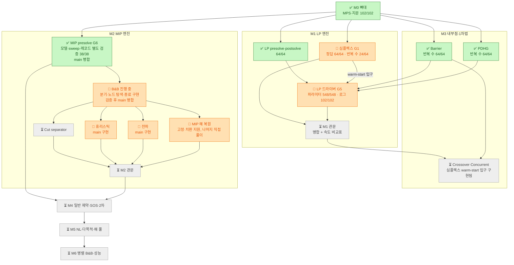

# 12. 로드맵 다이어그램

상태: ✅ 완료 · 🔄 진행 · 🔎 에이전트 검증 완료·병합 대기 · ⏳ 예정 (2026-11-09 기준. main에 병합된 구현과 남은 작업을 표시한다. 세부 기록은 [11_progress.md](11_progress.md), 심플렉스 최신 검증은 [10_porting.md §9.2](10_porting.md))

## 현재 작업 범위

- 상세 기록의 위치는 [문서 안내](README.md)에서 찾을 수 있다.

- `rsolver-barrier`의 `m2-mip-presolve`에는 B&B, 루트 전파·휴리스틱과 Python MIP 풀이가 있다. presolve 연결과 고정·치환 해 복원은 `13ce2fe`에 커밋됐고 `3e5c9d4`로 main에 병합됐다. 진행 문서 변경은 미커밋이다.
- 다른 MIP 복원 레코드와 빈 축약 모델은 원래 모델 직접 풀이로 돌아간다. LP presolve→simplex→postsolve 연결, MIP 콜백과 cut separator는 남아 있다.
- G6의 모델·레코드·PRELIMIT 저장 변화점 및 최종 모델 38/38을 2026-11-09 별도 검증했다. 38개에서 실행되지 않은 하위 풀이는 미구현이며 `3e5c9d4`로 main에 병합됐다. 범위는 [m2_presolve.md](m2/m2_presolve.md)에 있다.
