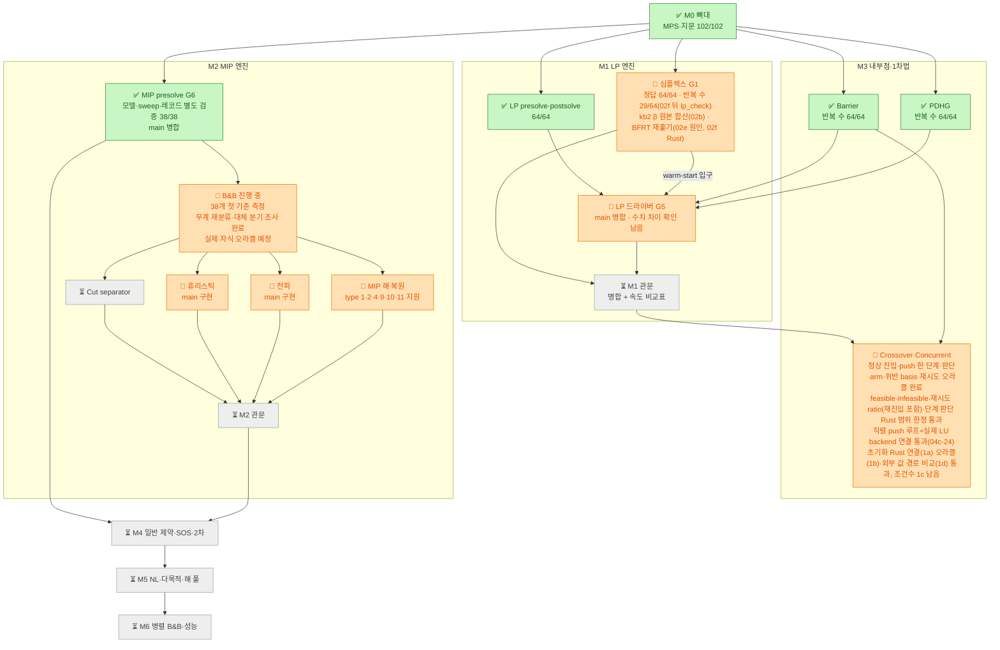

# 12. 로드맵 다이어그램

M3-04c-1d Rust push 초기화의 외부 값 경로를 1b 오라클로 비교했다(계약 범위 통과). `PushInitBackend`에 `12f282` 경계(`condition`, first일 때 라운드마다)와 관측 사건(잔차·강화·조건수 직전·조정 gate)을 더하고, 1b 15사례·17 push 호출을 push:enter 상태 + 외부 값(τ_in·S+0x120·S+0x3c8·환경 flag·`12f282` 출력, first=0만 FTRAN 출력)으로 재생했다. 초기 재분해 입력은 같은 기저 모델의 1a 입력을 쓰고 편집 전 push:enter가 같음을 확인했다. 첫 비교에서 quality retry 반환의 S+0x390 보고 1곳이 달랐고(`InitResult.markowitz`를 루프 준비에서만 갱신, 1a 자연 자료에 retry 없음), 강화 지점에서 갱신하도록 고친 뒤 **17호출·132줄·727필드 전부 일치**했다: 기준 조정 2라운드(τ'·재구성·-1/-2 승격·-4/-5 생략), Markowitz 강화와 `061bfe` 한도 200→50, 잔차 > 1e-6 수치 카운터, P > 1e10·PInf > 1e15 retry와 call 1 factor를 이어 받은 attempt=1 재호출, slack -2 = 직전 xmm0, 열 -5 = ub, first=0. 기대 줄 변조 710종 전부 거부, Rust 변이 29종 중 거부 24·생존 5(S+0x120 ≥ τ·0.1셈 ≥ 후보·x = lb+τ'·attempt=1 gate 항·P·cond 단독 결정: 자료에 경계 없음). workspace 147통과·clippy 0, 1a·24·1b 회귀 통과. 조건수 값은 주입(계산은 1c), 합성은 바꾼 입력에 대한 원본 동작과의 일치다. 원본 실행 0회, 독립 검토자 미사용. 다음은 **M3-04c-1c**(조건수 `116fd7`). [기록](m3/primal_push_init_ext_rust.md)

M3-04c-1b push 초기화 중간 경계·미관측 분기 오라클을 구축했다(오라클 완료, Rust 비교 없음). 읽기 전용 agent(`tools/push_init_agent.js`)가 τ_in(param_1, `0x1ee0(%rsp)`)·초기 재분해 반환·`09cf9b` dense FTRAN 입출력·`089d8f` 잔차 입출력·Markowitz 강화(`0x1c151c`)·`12f282` 전후 condition·조정 gate(셈 3개·후보 수·τ'·S+0x120)를 기록하고, 원본 명령 합성은 push 진입 또는 첫 FTRAN 직전에 지정 필드만 바꾼 뒤 원본이 그대로 실행한다. Netlib 소형 45×Crossover 3·1 자연 탐색 90회에서 조정·강화·retry·slack -2·-5는 **0회**, Crossover=1은 모두 first=0이었다. 정식 15사례(자연 6·first=0 1·합성 8: 기준 조정, 강화 1e-4·`061bfe` 한도 200→50, 0.5 강화+수치 카운터+P>1e10 retry, PInf>1e15 retry, slack -2 = 직전 xmm0, -5 = ub) × 독립 3회가 바이트 동일, 4사례 4회째 재캡처도 같고, 자연 6사례는 21h와 비간섭 일치했다. 검사기는 C 규칙 재계산(FTRAN 입력·잔차 출력·Markowitz 판단·gate·조정 τ'·재구성·첫 supply 상태)과 17 push 호출 모두 비트/정확 일치하고 변조 25종·필수 변이 9종을 거부한다(생존 5: 정확 경계·0.25 후보·√m 항, 자료에 없음). 원본 사실: 첫 push 진입 S+0x120은 이미 τ보다 작아 조정은 PInf>1만으로 열리고, 품질 retry 뒤 caller는 attempt=1·S+0x390=0.9로 다시 부른다. 독립 검토자 미사용. 다음은 **M3-04c-1d**(이 자료로 Rust `push_init` 외부 값 경로 비교)와 **1c**(조건수). [기록](m3/primal_push_init_oracle.md)

M3-04c-1a Rust push 초기화를 루프에 연결했다(계약 범위 통과). `crossover_init::push_init`이 `134a87` C 150–1142(요청 10 초기 재분해·rhs/후보 스캔·`aabbe3` 정렬·dense rhs FTRAN·`089d8f` 잔차·Markowitz 판단·lower shift/폭/분류·품질 gate·1회 기준 조정·루프 준비)를 옮기고, `SerialStart`가 초기 재분해 입력으로 Rust `refactor`를 부른 뒤 24의 `SerialBackend`·`push_loop`으로 넘긴다. 입력은 push:enter 상태와 초기 재분해 입력뿐(루프 시작 상태·수치 출력 없음)이며 자연 6사례 **731줄·5,743필드**(24의 725줄 + 루프 시작 start 6줄, 후보 순서·rhs·**basic 비트**·폭·표시·PInf·카운터)가 첫 비교부터 일치했다. trace 변조136 전부 거부, Rust 변이73 중 거부51·생존22(초기화 9: lb=0·lb=ub·자연 0회·동치, 나머지 24와 같음), workspace 146통과·clippy0, 22·24·survey 회귀 통과. 기준 조정 조건은 asm `0x1c1873`대로 `이전 PInf < τ`로 구현하고 조사 문서의 방향 오기를 정정했다. 조건수 항(1c)과 외부 값이 필요한 조정·Markowitz 강화 경로는 미검증이다. 원본 실행0회, 독립 검토자 미사용. 다음은 **M3-04c-1b** 초기화 중간 경계·미관측 분기 오라클이다. [기록](m3/primal_push_init_rust.md)

M3-04c-1 primal push 초기화를 조사했다(조사 완료, Rust 구현 없음). `134a87` 진입부터 첫 패스 준비(`0x1c1ff8`)까지를 10단계(할당·요청 10 초기 재분해·rhs/후보 구성·`aabbe3` 정렬·dense rhs FTRAN·잔차/Markowitz 강화·shift/폭/분류·품질 gate·1회 기준 조정·루프 준비)로 C/asm에 고정했다. asm으로 원본 특유 동작 둘을 확인했다: 첫 구성의 slack -2는 직전 xmm0을 rhs에서 빼고(`0x1c4f3d`), 기준 조정 재구성은 -4·-5 열을 rhs에서 빼지 않는다(`0x1c1cae`). 21h 자연 6사례×3회 캡처의 push:enter만으로 후보 순서·rhs S+0x200·폭·표시·PInf·반복·지원 flag를 다시 계산해 첫 supply:enter와 **1,480필드**가 첫 실행부터 비트/정확 일치했다(`tools/push_init_survey.py`, 동률 때문에 4사례는 안정 정렬과 순서가 다름). 변조11 전부 거부, 규칙 변이7 중 생존3(slack -2·-τ 경계·-4 값, 자연 미경유·동치). 기준 조정·Markowitz 강화·품질 retry·slack -2·열 -5는 자연 0회, basic 값·조건수 `116fd7`은 미비교다. 원본 실행0회, 독립 검토자 미사용. 후속은 **M3-04c-1a** Rust `push_init`+`push_loop` 연결, **1b** 중간 경계·미관측 분기 오라클, **1c** 조건수 이식이다. [기록](m3/primal_push_init.md)

M3-04c-24 실제 Rust 직렬 backend를 push 루프에 설치했다(계약 범위 통과). `crossover_backend::SerialBackend`가 21b–21h의 `LuState`(공급·rhs FTRAN, 지원 BTRAN, FT 갱신, 재번호)와 `refactor`(`036ade`+`1da0b2` 블록 단계)를 22의 `push_loop`에 연결하고, factor 판단 통계를 원본 규칙대로 만든다: F+0x190은 FT마다 작업 열 count+1 누적·재분해에서 0(`05b257` C:144–251·1379), F+0x1e0 = m+F+0x58[m], F+0x1e8 = F+0xb0[m]+m(C:1978–1986). 초기화 factor 입력(21h 첫 재분해와 같음)만 받고 원본 수치 출력·factor 재주입 0회로 자연 6사례 **725줄·5,575필드**(22의 719줄 + init 6, fcall 통계 49)가 첫 비교부터 비트/정확 일치했다(FT 36·재분해 19·FTRAN 120·BTRAN 32). trace 변조108 전부 거부, Rust 변이44 중 거부31·생존13(F1d8=r cache 재사용·S+0x2c0>20 등 자연 미경유와 동치), workspace 145통과·clippy0, 22 tape·21h 연쇄 등 회귀 12명령 통과. 원본 실행0회, 독립 검토자 미사용. 초기화의 나머지·해 설치·solver 경로 연결·품질15a·batch23은 미검증이다. [기록](m3/primal_push_loop_lu.md)

M3-04c-22 초기화된 직렬 push 루프를 연결했다(계약 범위 통과). `crossover_loop::push_loop`이 첫 패스 준비(`0x1c1ff8`) 직전 상태에서 패스 준비·공급자·단계 선택/적용·승인/보류·지원 BTRAN(dense면 round)·factor 판단/wrapper·pivot 재계산·품질 주기·고갈 gate·지원 gate/압축·round factor·재계산·요청 지우기를 C 1143–2418 순서로 잇고, 재분해 뒤 header·vstat·S+0x2f8 재번호(`05b257` C:2036–2090)를 backend 순열로 적용한다. `crossover_factor`에는 재계산 뒤 품질 검사부터 재개하는 `factor_resume`만 더했다. 수치 결과(공급 FTRAN·지원 BTRAN·`05b257` 반환/카운터/통계/순열·재계산 FTRAN)는 21e 캡처의 출력 tape이며 원본 상태 재주입은 0회다. 자연 6사례(arms·retry·interior·adlittle·scsd1·capri)에서 **719줄·5,502필드**(패스14·공급119·단계107·BTRAN32(dense2)·판단67·`05b257` 49·재계산13·round12·종료6)가 비트/정확 일치했고, trace 변조103 전부 거부, Rust 변이25 중 거부18·생존7(재계산 전후 위반 수 동일·ratio 요청 항상 0·품질 주기 50 고정 등 자연 미경유 경로), workspace 144통과·clippy0, 선행 L1 재생 회귀 통과. 실제 Rust LU를 루프에 설치하는 검증은 M3-04c-24, 초기화·해 설치·batch·품질 수치는 미검증이다. [기록](m3/primal_push_loop_rust.md)

M3-04c-21h `1da0b2` 2×2 블록 단계를 이식했다(계약 범위 통과). M1 `Lu`에 상태 입력형 `factor_block`(S+0x2c0/0x4e0/0x4e4)과 블록 단계(C:681–1510: 행 쌍 A·열 쌍 B의 체인 해시 짝짓기, |a| 큰 쪽 첫 피벗, Schur |s| ≥ 1e-10 수용, 블록 뒤 singleton 스택, 상태 갱신 C:1494–1510)를 C 그대로 옮겼고 F+0xe4는 블록 전 단계 수다. 블록 상태는 21e 훅 경계에 읽기만 더한 새 캡처(7사례 × 3회, 21e 투영 비간섭, 변조14 거부)로 얻었다: push의 S는 (1,0,0)에서 시작하고 블록 단계는 capri 3회만 돈다. 첫 push 재분해 상태만 넣고 이후 Rust 연쇄로 재생해 **재분해 19/19·219/219연산**이 원본과 비트 일치했다(필드 1,262,508, 예상 실패 0). 21g 예상 실패 capri 23회째는 **B 단계** 블록 {행 218, 217}×{위치 152, 206}과 열 singleton 1개였다. trace 변조54 거부, Rust 변이23 중 거부12(필수 `block-phase-skipped` 포함)·생존11(A 단계 피벗 0회 등 자연 미경유 분기), A·B 합성 단위 테스트는 B = LU 정합성만 확인했다. M1 simplex는 블록 단계를 끈 채라 결과 불변이며, M1에서 켜는 일과 t = s3 정정은 **M1-02w**로 넘긴다. 원본 실행22회, 독립 검토자 미사용. 다음은 **M3-04c-22 push 루프 연결**이다. [계약과 결과](m3/primal_push_block_rust.md).

M3-04c-21g push 재분해 factor 생성을 구현했다(계약 범위 통과, 사전 명시 예상 실패 1재분해). M1 `Lu::factor_tol`(`1da0b2` singleton 단계와 `036ade` Markowitz 커널)을 동작 변경 없이 부르고, 결과를 원본 배열 표현(순열·대각·L 열/행과 레벨·U 열/행의 풀 위치·스칼라·접두·F1a0)으로 옮기는 `crossover_refactor` adapter를 만들어 21f 연쇄의 재분해 주입점을 없앴다. push 자연 7사례 재분해 19회 중 18회(삼각 9·커널 9, L/Lᵀ 레벨 2)의 factor 전체가 원본과 비트 일치하고, 그 위에서 FT 36·FTRAN 119·BTRAN 32가 원본 factor 재주입 없이 일치했다(211/213연산, 필드 1,234,852). 나머지 capri 23회째 재분해는 원본이 `1da0b2` 2×2 블록 단계(활성 ≥ 50, 상태 S+0x4e0/0x4e4)로 피벗해 계약 전에 예상 실패로 명시했고 실제로 그 재분해와 다음 FTRAN에서 실패한다. 원본 F+0x100(t)는 열 singleton 단계 3의 끝(s3)인데 M1은 앞쪽 빈 U 열 수로 세서 adlittle에서 어긋났다. adapter는 s3를 쓰고 M1은 바꾸지 않았다. trace 변조42·Rust 변이23 전부 거부, workspace139통과·ignored12·clippy0, 원본 실행0회, 독립 검토자 미사용. 다음은 **M3-04c-21h 2×2 블록 단계(M1 조율)** 또는 **M3-04c-22 push 루프 연결**이다. [계약과 결과](m3/primal_push_refactor_rust.md).

M3-04c-21f 직렬 numeric backend 연쇄를 구현했다(계약 범위 통과). 원본 factor 배열 표현(U·eta 공용 풀 위치 포함)을 상태로 갖는 `crossover_lu`가 push 안 factor 연산을 순서대로 처리한다: FT 갱신 `05b257`(C:144–1335)과 행 eta `09e47c`(= 입력 e_r·출력 cache인 `21a941`), 재분해의 push 상태 재번호(header·이탈 위치·vstat·spike·cache), 공급 wrapper의 spike clear 뒤 21b FTRAN·21d BTRAN. 재분해 지점의 `036ade` 결과(분해 뒤 설정 C:2570–2760 포함)만 원본에서 주입하고 그 사이에는 원본 factor를 다시 넣지 않았다. 7사례 207연산(재분해19·FTRAN120·BTRAN32·FT36)의 factor 전체·출력·spike·cache·bucket이 원본과 비트 일치했다(필드 1,257,225). 연쇄에서 드러난 원본 사실: U 열 배열은 풀+분해 직후 F+0x160/2에서 시작하고(`036ade` C:5378), 재분해 뒤 F+0x40/0x48은 F+0x28/0x38 버퍼를 가리키며, FTRAN `21b9de` 레벨 경로 A2는 BTRAN level bucket과 같은 F+0x1a8을 쓴다. A2를 21b adapter에 새로 구현했다(capri 25회). trace 변조45 거부, Rust 변이 24종 중 거부21·시간초과1·생존2(동치1·판별불가1). cache 재사용·FT 실패 경로·BTRAN eta>0은 자연 0회, cache 버퍼 정렬은 판별되지 않았다. 원본 실행0회, 독립 검토자 미사용. 다음은 **M3-04c-21g `036ade` 분해 생성**(주입점 제거)이다. [계약과 결과](m3/primal_push_lu_rust.md).

M3-04c-21e 지연 LU 연쇄 수치 오라클을 완료했다(계약 범위, Rust 수치 동등성 미검증). push 안 factor 처리 `05b257`의 진입·반환에서 factor 전체(L 열·행, U 열·행, eta, 순열, 접두)·spike·cache F1d0/F1d8·header·vstat를, FT 행 eta `09e47c`와 재분해 `036ade` 경계(identity로 덮기 전 순열)를 읽기 전용 훅으로 모아 21a/21c FTRAN·BTRAN 스냅숏과 한 사건열로 이었다. 21c와 같은 7사례 각 독립3회가 같고 새 사건을 빼면 21c 정식 캡처와 전체가 같다. `05b257` 55호출(FT 갱신36·재분해19)과 연산 사이 연결188개 전부 C 규칙을 통과했다: factor는 연산 사이 header 외 전부 보존(header만 바뀐 연결68), FT 갱신은 C:263–320 구간식대로 행 eta 호출(26)·F18c+1·spike 비움, 재분해는 `036ade` 순열로 header·이탈 위치·vstat 재번호와 spike idx/header 버퍼 교환 뒤 identity. 변조54종 거부. FT의 cache 재사용(F1d8=r)·반환≠0·singular·pricing 경로와 지원 BTRAN eta>0(32회 모두 직전이 재분해)은 미관측이다. 정식1차는 push 초기화 첫 호출의 미초기화 순열로 재현성 거부돼 history에 보존했다. 원본 실행50회, Rust 변경0, 독립 검토자 미사용. 다음은 **M3-04c-21f 직렬 numeric backend 연쇄 구현**이다. [계약과 결과](m3/primal_push_lu_chain_oracle.md).

M3-04c-21d 지원 BTRAN Rust adapter를 완료했다(계약 범위 통과). 원본 factor 배열 표현을 그대로 받는 `crossover_btran`이 `221173` 본체(cache 경로·일반 희소/조밀 Uᵀ 판정·eta·Lᵀ heap/level/B/조밀·F+0x20 치환·F+0x30 gather·헤더 교환)와 희소 Uᵀ 커널 `21a941`(heap·순차·F108>5)을 옮겼다. 21c 자연 32호출의 커널 경계64·raw·입력 후상태·별칭·cache·F1d8·scratch·level bucket과 F+0x200 work까지 3,096필드가 원본과 비트 일치했다(첫 실행부터). 변조600종 거부, Rust 변이32종 중 거부21·생존11(heap↔순차 전환 동치4, 원본 자료에 없는 동률·경로 B·정수 work 결합 경계7). 조밀 Uᵀ·eta(조밀·희소)·경로 B·커널 F108>5는 C 근거 구현으로 미검증이다. workspace137통과·ignored12·clippy0, 원본 실행0회, 독립 검토자 미사용. 밀도 근사 계산(M1-02k)은 21f로 넘겼다. 다음은 **M3-04c-21e 지연 LU 연쇄 오라클**이다. [계약과 결과](m3/primal_push_btran_rust.md).

M3-04c-21c 지원 BTRAN 수치 오라클을 완료했다(계약 범위, Rust 수치 동등성 미검증). push 지원 라운드의 `09e376→221173` 본체와 희소 Uᵀ 커널 `21a941` 경계에서 초기 factor 전체(L 열·행 방향·level, U 열·행, eta, 순열)·입력·cache F1d0/F1d8·커널 in/out·raw·입력 후상태·별칭·scratch를 읽기 전용 훅으로 모았다. 선행 자연 22회가 모두 한 경로(U 행 빈·eta0·희소 Lᵀ)라 경량 조사 훅으로 Netlib 54모델 401호출을 훑어 adlittle·scsd1·capri를 자연 사례로 더했다. 7사례 각 독립3회가 같고, 새 사건을 빼면 선행21a(Netlib은 21a agent 기준선)와 전체 사건·결과가 같다. 32호출 전부 C 규칙(cache 경로 25빈/7비영·cache=Uᵀ 출력·F1d8, 일반 희소 Uᵀ 판정, Lᵀ 희소30/조밀2 표현, L 행=열 전치, wrapper raw)을 통과했고 변조41종을 거부했다. eta>0·조밀 Uᵀ·커널 출력0은 자연 0회라 미관측이다. 원본 실행36회, Rust 변경0, 독립 검토자 미사용. 다음은 **M3-04c-21d Rust BTRAN adapter**다. [계약과 결과](m3/primal_push_btran_oracle.md).

M3-04c-21b 한 RHS FTRAN Rust adapter를 완료했다(계약 범위 통과). 원본 factor 배열 표현을 그대로 받는 `crossover_ftran`이 `2207de` 본체와 `214344`·`21b9de` A1·row eta·spike·`2126cd`·`21686f`를 원본 버퍼 교환까지 옮겼고, 21a 자연 50호출의 커널 경계 200사건·raw·입력 후상태·별칭·spike·scratch(5,520필드)가 원본과 비트 일치했다. 같은 커널의 M1 원본 186호출(`21686f` S1/S2/H1/H2·`21b9de` A1)도 일치한다. trace변조1,493종 거부, Rust 변이26종 중 거부17(재생 중단2 포함)·생존9이며 생존은 ZERO 경계·긴 eta·save∉{0,1}·`count·F104=m` 동률 등 원본 자료에 없는 경계라 미검증으로 남겼다. workspace136통과·ignored12·clippy0, 21a·round·chain 회귀 통과, 원본 실행0회. sparse R·count0·`21b9de` A2/B·`21574d`·M1 `Lu` 통합·factor 수명은 범위 밖이다. 다음은 **M3-04c-21c 지원 BTRAN 수치 오라클**이다. [계약과 결과](m3/primal_push_ftran_rust.md).

M3-04c-21a 한 RHS FTRAN 수치 오라클을 완료했다(계약 범위, Rust 수치 동등성 미검증). push 안 `2207de` 본체를 공급자·재계산 wrapper에서 부르는 50호출의 초기 factor 전체(순열·L/U·접두·eta·풀·scratch)·입력·L/U 커널 경계·spike·raw·입력 후상태·별칭을 자연3모델·대조군 각 독립3회로 캡처했고, 새 사건을 빼면 선행19 전체 사건·최종 결과와 같다. 원본 C에서 다시 계산한 입력 치환/gather·L/U 경로 판정·spike 저장/clear·출력·factor 불변·scratch 0 규칙이 50호출 전부 통과했고 변조36종을 각 규칙에서 거부했다. eta>0 5회·희소 U 33회·dense spike 8·sparse spike 1을 관측했고 count0·레벨 L·`21574d`·접두 있는 희소 U·sparse R(eta>0)은 미관측이다. 선행 round/survey/chain 회귀 통과, 새 원본 21회(탐색8·정식12·검토1), 독립 검토 통과, Rust 변경0. 다음은 **M3-04c-21b** Rust 한 RHS FTRAN이다.

M3-04c-21 직렬 수치 backend 연결 조사를 완료했다(신규 수치 동등성 미검증). 한 RHS FTRAN의 입력 변환·L/R 뒤 spike·버퍼 교환, 지원 BTRAN의 Uᵀ cache, 지연 factor와 현재 header·재분해 순열을 C/asm·M1 Rust API로 대조했다. 선행19 대표 자연3모델751사건에서 FTRAN42·BTRAN22·factor16(FT5)·재계산8·pivot factor 생략22를 집계했고 source/asm 해시·재생·입력 무결성8종 거부·선행4검사기/chain 회귀가 통과했다. 새 원본0회·Rust 코드 변경0·독립 검토자 미사용. 다음은 **M3-04c-21a FTRAN 수치 오라클**이며, FTRAN21a→b·BTRAN21c→d·지연 LU/재분해21e→f로 나눴다. 루프22·품질15a·batch23·x87·전체work/P3는 별도다. [계약과 결과](m3/primal_push_lu_survey.md).

M3-04c-20 보류·지원·라운드 제어를 Rust L1으로 완료했다(계약 범위 통과). 자연110+합성106, 총216경계·14,365필드의 후보/실패·지원 표시·승인수·압축·요청10·종료·round factor/retry가 원본 저장 자료와 정확/비트 일치했다. trace변조4,093종·임시 사본 Rust변이39종을 전부 거부했다. workspace134통과·기존 ignored12·clippy0, 선행 재계산/factor/supplier/chain 회귀도 통과했다. 원본19 독립3회 자료 재사용·새 원본 실행0회·독립 검토자 미사용이다. 수치 BTRAN/factor는 외부 backend이며 solver 루프·실제LU21·연결22·batch23·x87·전체work/P3는 미검증이다. 다음은 **M3-04c-21 직렬 수치 backend 연결 조사**다. [계약과 결과](m3/primal_push_round_rust.md).

M3-04c-19 보류·지원·라운드 오라클을 완료했다(계약 범위 통과). 자연3모델751사건 중 새207사건과 합성106경계를 각각 독립3회 재현·제어 재생하고 선행17 전체사건·최종 출력과 비간섭을 확인했다. 자연 승인36·보류6·고갈9·round factor7·BTRAN22회(모두count1)이며 count0/다수/dense·오류 경계는 합성 증거다. 독립검토에서 생존한 BTRAN caller 연결3종을 보강해 변조157종·직접9종을 거부했고 검토자의 원본2회 재캡처도 일치한다. 선행 회귀·Rust236단계/5,144필드 비트 일치가 유지된다. 신규 Rust·실제LU21·루프22·batch23·x87·전체work/P3는 미검증이다. 다음은 **M3-04c-20 round Rust L1**이다. [계약과 결과](m3/primal_push_round_oracle.md).

M3-04c-18 재분해 뒤 재계산을 Rust L1으로 완료했다(계약 범위 통과). basic 복사/제자리·하한 이동·폭·분류·위반수·PInf·retry·요청 보존이 자연8+합성130, 총138입력·289행·2,958필드에서 원본과 비트/정확 일치했다. 기존 누적 사례가 역순 변이를 구분하지 못한 실패를 보존하고 추가 원본10사례를 독립3회 캡처해 trace변조84종·Rust변이33종을 모두 거부했다. workspace133통과·기존 ignored12·clippy0, factor/supplier/chain 회귀가 통과했다. 독립검토의 원본 추가10사례 재캡처 일치·직접16변조 거부도 확인했다. 새 원본 실행4회(작업자3+검토1). FTRAN 수치는 외부 입력이며 실제LU21·루프22·batch23·x87·work/P3·전체 crossover는 미검증이다. 다음은 **M3-04c-19 보류·지원·라운드 오라클**이다. [계약과 결과](m3/primal_push_recompute_rust.md).

M3-04c-17 재분해 뒤 재계산 오라클을 완료했다(계약 범위 통과). 두 진입점의 자연8회(pivot1/round7)·119행 및 원본 명령 합성120사례·152행이 독립3회 재현·제어 재생에서 비트 일치했다. 새 header·rhs 복사·raw FTRAN·하한 이동·폭·분류·위반수·PInf·retry·별칭을 비교하며 변조82종을 모두 거부했다. 독립 검토자가 자연/합성을 각각1회 재캡처해 일치를 확인했고 추가15변조도 거부했다. 선행 factor/supplier/chain 회귀와 Rust236단계·5,144필드 비교도 통과했다. 자연 별칭 true·free/fixed·retry는 미관측(합성 보강), 실제 LU21·루프22·batch23·x87·work/P3와 Rust 신규 구현은 미검증이다. 다음은 **M3-04c-18 shift·분류·PInf·retry Rust L1**이다. [계약과 결과](m3/primal_push_recompute_oracle.md).

M3-04c-16 직렬 factor 제어를 Rust L1으로 완료했다(계약 범위 통과). 자연 판단28·호출6과 합성55경계, 총89입력·978필드가 원본과 일치했다. 요청 선택·alpha 참조 설치/복원·반환1 반복·retry/status·품질 주기를 검증했고 비교기 변조55종·Rust 동작 변이30종을 모두 거부했다. workspace132통과·기존 ignored12·clippy0, supplier69입력·1,311묶음과 push 연쇄236단계·5,144필드 회귀도 일치한다. 원본 독립3회 자료 재사용·새 원본 실행0회다. 실제 factor/quality 수치·재계산 본문·루프 연결은 제외했다. 다음은 **M3-04c-17 재계산 오라클**이다. [계약과 결과](m3/primal_push_factor_rust.md).

M3-04c-15 직렬 factor 제어 오라클을 완료했다(경계 한정). 자연3모델·대조군 각 원본3회가 재현·기존13 비간섭 검사를 통과했다. 자연 판단28회는 호출6·support 생략22이며, wrapper6회의 alpha 복원·spike 보존을 확인했다. 원본 명령 구간의 합성55사례(선택24·wrapper31)도 독립3회와 제어 재생이 일치하고 변조41종을 거부했다. 실제 품질 helper는 자연0회이며 합성의 factor/quality는 외부 backend다. Rust 연쇄236단계/5,144필드 회귀는 유지한다. 다음은 **M3-04c-16 factor 제어 L1**이며 품질 수치15a·재계산17·실제LU21·batch23은 별도다. [계약과 결과](m3/primal_push_factor_oracle.md).

M3-04c-14 단일 후보 공급자 제어를 Rust L1으로 완료했다(계약 범위 통과). 원본 자연51·합성18입력의 후보·보류·호출·통계·dense 압축과 후상태를 1,311필드 묶음으로 비교해 정수·순서·f64 비트가 일치했다. 비교기 변조29종·Rust 동작 변이22종 모두 거부, workspace131통과·clippy0·기존 Rust 연쇄236단계/5,144필드 일치를 확인했다. 원본 독립3회 자료를 재사용했고 새 원본 실행0회다. FTRAN은 외부 backend이며 실제 LU21·루프 연결22·batch23·전체 push는 미검증이다. 다음은 **M3-04c-15 factor 제어 오라클**이다. [계약과 결과](m3/primal_push_supplier_rust.md).

M3-04c-13 공급자 원본 오라클을 완료했다(범위 한정). 자연51공급·합성18경계를 독립3회 재현하고 후보·보류·통계·FTRAN 입출력/별칭·압축을 대조했다. 내부 raw dense9회는 interior에서 실제 관측됐으며 sparse 반환만으로 경로를 추정하지 않는다. 변조31종·독립 검토 추가7종 거부, 자연/합성 재캡처 일치, 기존 Rust236단계 회귀 통과. 다음은 **M3-04c-14**(외부 FTRAN backend를 쓰는 공급자 제어 L1)다. 실제 LU 연결21·루프 연결22·batch23과 전체 crossover는 남아 있다. [계약과 결과](m3/primal_push_supplier_oracle.md).

M3-04c-12 push 루프 본체 분할 조사를 완료했다(구현 동등성 미검증). 후속은 공급자13→14·factor제어15→16·재계산17→18·라운드19→20(각 오라클→L1 구현), 수치 LU 연결 조사21·초기화된 제어 연결22·batch 조사23이다. 기존 자연18기록을 재검사·집계했고 Rust 연쇄236단계·필드5,144 비트 일치를 다시 확인했다. 새 원본 실행0, 수치 backend와 전체 push는 미연결이다. 다음은 **M3-04c-13** 또는 dual push(M3-04d)다. [상태·근거·후속 계약](m3/primal_push_loop.md).

M3-04c-11 push 한 단계 연쇄의 생존 경계(lb≠0·위반 해소·자유 열 flip·F 행 루프)를 원본 캡처로 확인해 Rust 변이 거부를 15→21로 늘렸다(Rust 변경 없음, 236단계 비트 일치). Frida는 프리로드 해석으로 이 컴퓨터에서도 돈다. 남은 것은 push 루프 본체(M3-04c-12)와 dual push(M3-04d)다. [계약과 결과](m3/primal_push_chain_oracle.md).

M3-04c-10 primal push 한 단계의 선택·적용을 Rust `push_pick`·`push_apply`로 연결해 범위 한정 완료했다. 자연 캡처 166단계를 연쇄 재생해 비트 일치했다. 남은 것은 lb≠0·위반 해소 원본 캡처(M3-04c-11, Frida 필요), push 루프 본체(공급자·factor 갱신 판단·재분해, M3-04c-12)와 dual push(M3-04d)다. [계약과 결과](m3/primal_push_step_chain.md).

M3-04c-9 `054eef`·`056973` 작은 pivot 재진입을 원본 합성 3회(231사례, 바이트 동일)와 Rust 재생으로 범위 한정 완료했다. 세 ratio(`055f68`·`054eef`·`056973`) 모두 재진입을 원본대로 돌고 Rust의 `Reentry` 거부가 없어졌다. 남은 것은 push 루프 연결과 dual push(M3-04d)다. [계약과 결과](m3/primal_push_violated_reentry.md).

M3-04c-5 `055f68` 작은 pivot 재진입과 `12dd49` 요청 2를 원본 합성 3회(91사례, 바이트 동일)와 Rust 재생으로 범위 한정 완료했다. 04c에서 생존한 2차 상한 동률·후보 있는 상한 I·0.1·계수표 변이를 모두 거부하게 됐다. 남은 것은 push 루프에서 요청 2 적용과 `054eef`·`056973` 재진입 Rust다.

M1-02v 반복 커널 work 19지점(`a4109`·`1c35c5`·`28c93`·`1c8477`·`2896a3`·`15d2d`)을 Rust에 복원했다(구현, 계약 범위 통과). 기존 02p·02q 캡처를 재생해 kb2 저장 758·degen2 피벗 0–355 저장 6,459회가 지점·순서·k·값 비트까지 같다(기존 지점 포함, 새 지점 저장 2,592회). 원본 직전 work + Rust 양 비교이며 전체 work 일치는 아직 아니다. 후보 1개는 BFRT 후속 저장을 건너뛰고, flip FTRAN의 조밀 반환에만 압축 비용을 저장한다. 기존 수치 풀이를 유지해 Netlib 경로 64개 출력·LP 273행이 기준 `27bbda9`와 같다. Rust 125·Clippy·pytest 657, M1 검사기 12종·BFRT 코퍼스 통과. 변조 28종 거부, 새 Rust 변이 14종 전부 거부(전체 38종 중 34 거부·기존 4 판별 불가). Gurobi 새 실행 0회. work 재분해 판정 미연결, 다음은 M1-02k → M1-02t와 M1-02u다. [계약과 결과](m1/m1_02v_iteration_work.md).

M2-06h-2 strong branching 첫 정수 후보의 up/down 제어를 Rust `crates/mip/src/strong_branch.rs`에 옮겼다(구현 L1, 조건부 통과). `695bd7`의 분기 bound 요청(`floor(x+IntFeasTol)+1`/`floor`)·flush·LP 호출·목적 clamp·반복 비용 누적·reset→basis restore→bound 복원 요청 순서를 외부 backend trait로 재생한다. pk1(Threads=1·Seed=0·NodeLimit=300·SBMAXITERS=10) 새 원본 독립 3회와 무훅 대조가 같고, 첫 후보 24개·48방향(상태7 42·상태2 6)의 명령·값이 u64 비트로 일치한다. 변조 17종·Rust 변이 4종 거부. 목적 clamp(base 선택) 두 분기는 원본 자료에 없어 미검증이며 합성 테스트만 잡는다. clamp는 asm `maxsd` 피연산자 순서로 맞췄다. 병합 뒤 사후 독립 재검토(중간 2·낮음 6)를 반영해 근거 줄·사례표·work 카운터 미이식을 정정했다. up 값 ≥ 1e100이면 원본은 down을 건너뛰는데(C:660), 이후 경로는 미이식이라 복구 뒤 `Unported`를 돌려준다. cargo workspace 127·clippy 0. 전체 LP 수치·추가 전파·모순·오류·후보 루프·부모 재풀이·B&B 연결은 미검증·미연결이며 M2-06h-3으로 넘긴다. [계약과 결과](m2/mip_sb_control_rust.md).

M2-06h-1 LP 저장·복구 오라클을 완료했다(관측 범위 통과). pk1, Threads=1·Seed=0·NodeLimit=300·SBMAXITERS=10에서 독립 3회 캡처가 동일하고 무훅 출력도 같다. 행/열 U 배열 저장 24회·복원 110회(up/down 각55), bound 요청 220회·큐 적용 134회를 원시 바이트로 비교했다. setter 직후에는 bound가 보존되고 `edd71` 반환 때 열 scale을 반영한 요청이 적용된다. 변조 19종 거부, 기존 06g-2 6사례 회귀와 독립 재검토 통과. Rust·Python 미변경. 전체 L/eta·비어 있지 않은 접두 행 목록·파생 스칼라·오류·x87·병렬·Rust 동등성은 미검증이다. 다음은 M2-06h-2(실제 LP 결과를 입력으로 받는 후보 제어 L1). [계약과 결과](m2/mip_sb_lp_snapshot.md).

M2-06g-2 SB 후보 분할·결과 소비·부분 상태 복구·반복 비용 계약을 원본 캡처로 확인했다(조사·오라클). 6사례 × 3회, 후보 분할 1,754·SB 149묶음·방향 복사 742가 규칙 재생과 같다. `691453`의 기존 “후보 평가” 설명을 부모 LP 확인으로 바로잡았다. 전체 factor 복구·오류·병렬은 미검증이다. 다음은 M2-06h-1(저장·복구 오라클) → 06h-2(후보 하나 L1 제어). [기록](m2/mip_sb_restore.md).

M1-02s `05b257` 뒤 처리 work 13지점(`1bae9c`·`1b7106`·`1ca57`·`16b0a`)을 옮겼다(구현, 통과). 재분해 진입 work를 원본 값으로 주면 kb2·degen2 피벗 0–355에서 분해·갱신·뒤 처리 저장 4,625개가 원본과 비트까지 같다. 반복 커널은 M1-02v로 나눴다. work는 아직 재분해 판정에 연결하지 않았고 Netlib 경로는 그대로다. 남은 묶음은 M1-02v(반복 커널)·02t(LU 풀이)·02u(`48d5f`·`8b473` 분기). [계약과 결과](m1/m1_02s_post_work.md).

M2-06g pseudocost 읽는 쪽 식(`6ef12f`·`6eed2e`)·SB 캐시(`6ee5d1`)·η 수명을 원본 캡처로 확정했다(조사·오라클). 6사례 101만여 호출이 비트·정확 일치한다. SB 풀이 결과 소비·복원표·후보 목록은 M2-06g-2로 나눴고 06h의 선행이 됐다. Rust·`bnb.rs` 미연결.

M1-02r FT 갱신 `05b257`의 work 저장 15지점과 재분해 경로 spike 지우기(0xf461f)를 옮겼다(구현, 통과). 재분해 진입 work를 원본 값으로 주면 kb2 전 구간·degen2 피벗 0–355에서 분해·갱신·재분해 뒤 저장 3,606개가 원본과 비트까지 같다. work는 아직 재분해 판정에 연결하지 않았고 Netlib 경로는 그대로다. 남은 묶음은 M1-02s(반복 커널·`1ca57`·`16b0a`)·02t(LU 풀이)·02u(`48d5f`·`8b473` 분기). [계약과 결과](m1/m1_02r_ft_work.md).

M2-06e-2 pseudocost 표 B 갱신과 표 C 용도를 원본 캡처로 확정했다(조사·오라클). 표 B는 노드 LP 최적 뒤 bound에 있는 비기저 정수 열의 환산비용을 방향별 5회까지 모으는 표이고, 6사례 18,774회 갱신과 work가 규칙 재생과 비트까지 같다. 표 C는 probing 결과(정수 Δ·2e9)를 모으는 표로 신뢰성 판정과 이득 추정이 읽는다. 다음은 M2-06g(SB 입력, 표 B를 읽는 `62f909` 포함), `bnb.rs` 연결 준비. [계약과 결과](m2/mip_pseudocost_bc.md).

M1-02q dual work 계수기를 Rust에 두고 분해(`036ade`)·재분해 뒤(`05b257`·`9e60b`)·시작 지점을 옮겼다(구현, 통과). 재분해 진입 work를 원본 값으로 주면 kb2 5회·degen2 피벗 0–355의 재분해 9회에서 저장 147회·spx+0x158·Markowitz 누적 항이 원본과 비트까지 같다. work는 아직 재분해 판정에 연결하지 않았고 Netlib 경로는 그대로다. 다음은 M1-02r(FT 갱신 지점)·02s(반복 커널·`1ca57`)·02t·02u. [계약과 결과](m1/m1_02q_work.md).

M2-06d-3 Rust plunge 선택에 규칙 4·7·9를 더했다(구현 L1, 통과). 06c-3 7사례 13,830호출의 선택·본문 조상 질의 순서·RNG·work·꼬리가 원본 캡처와 같고, 06d에서 원본 선택을 빌려 쓰던 402호출이 0이 됐다. 판별되지 않은 절(규칙 4 나눗수 등)은 asm대로 옮겼다. 다음은 `bnb.rs` 연결 준비(`(*W)+0x60`·k 갱신), M2-06e-2, M2-06g. [계약과 결과](m2/mip_plunge_r47_rust.md).

M2-06c-3 plunge 규칙 4·7·9 점수, 규칙 1·6 본문의 조상 질의, 규칙 5 뒤 RNG를 새 캡처 재생으로 확정했다(조사·오라클). 06c 도구에 사건만 더한 새 도구로 7사례(06c 5 + BranchDir ±1)를 3회씩 잡았고, 새 사건을 뺀 투영은 기존 자료와 같다. 규칙 4 347·7 38·9 3,966호출의 선택, 본문 질의 28,245개의 순서, 06c-2 재생 불가 34호출을 포함한 규칙 1·6 전체 선택이 원본과 같다. 다음은 M2-06d-3(Rust `pick`에 4·7·9 추가). [계약과 결과](m2/mip_plunge_r47.md).

M1-02p dual work 누적의 출처를 원본 캡처로 확정했다(조사·오라클, 완료). work 쓰기는 20함수 69지점이고, 재분해 work 조건의 필드(0x150 분해 시작 work, 0x158 분해 증분 평균, 0x3d0 nnz(A))는 재분해 21회에서 비트까지 같다. 판정은 분해 구간 work 합 전체를 쓰므로 열 묶음(분해·재분해 뒤 정리·FT 갱신·반복 커널·`05b257` 뒤 처리의 피벗마다·목록 재구성·재분해 뒤 부분·LU 풀이·분기 합·모델 상수)을 모두 옮겨야 degen2 피벗 356 재분해를 재현한다. 다음은 M1-02q(work 틀과 분해 지점). [계약과 결과](m1/m1_02p_work.md).

M1-02n FT 갱신의 접두 경계와 재분해 판정을 원본 캡처로 확정하고 접두 경계를 고쳤다(조사·구현, 통과). Rust가 행 r을 U 열에서 지우는 일(LU+0xe8 올림)을 접두 판정 앞에 해서 피벗 313·326 뒤 t가 1 컸다. 순서를 원본대로 두자 degen2 피벗 0–355·kb2 0–37의 FTRAN 시점 접두 상태가 원본과 같고 02m 제외 7피벗이 없어졌다. degen2 경로 첫 차이 357은 재분해 판정의 work 조건(갱신 % 10 = 9에서 분해 이후 work 비교)이라 simplex work가 필요하다. Netlib 결과·경로 첫 차이는 기준선과 같다. 다음은 M1-02p(dual work 누적). [계약과 결과](m1/m1_02n_update.md).

M2-06d plunge 선택(규칙 번호·RNG·규칙 1·2·3·5·6·12·꼬리)을 Rust `plunge`로 옮겼다(구현 L1, 통과). 06c 5사례 9,864호출의 시드·규칙·선택·work·꼬리 처리가 원본 캡처와 비트까지 같고, 변이 17종이 06c·06c-2 변종과 같은 사례에서 거부된다. 규칙 4·7 점수와 `bnb.rs` 연결은 남았다. 다음은 M2-06c-3(규칙 4·7). [계약과 결과](m2/mip_plunge_rust.md).

M1-02m 희소 U 커널의 접두 행 순서를 원본대로 만들었다(조사·구현, 통과). 커널 경로 네 개 중 H2만 "구간 2"(처음 닿은 순)이고 그 순서는 U 열 저장 순서([꼬리 | 접두])에 달려 있어 `05b257`의 열 유지 규칙과 분해 직후 순서를 옮겼다. degen2 희소 U 231/238피벗(제외 7은 접두 길이 t 차이, M1-02n)·kb2 7/7에서 U 열 상태·커널 출력·입력 순서가 원본과 같다. Netlib 결과·경로는 기준선과 같다(degen2 첫 차이 357은 재분해 판정). 다음은 M1-02n(피벗 313 갱신 뒤 t·LU+0xec, 피벗 356 재분해 판정), M1-02o(τ 값).

M2-06c-2 plunge 규칙 1·2·5·6의 선택 점수를 06c 캡처 재생으로 확정했다(조사). 규칙 1·6은 첫 최심 항목의 조부모와 조상이 같은 형제만 보고(6은 최소 est, 1은 얕은 쪽), 2는 최소 est, 5는 정수 난수 mod n이다. 선택 7,465호출과 모든 규칙의 work 9,864호출이 비트까지 같다. 다음은 M2-06d(Rust 이식)와 M2-06c-3(규칙 4·7, 새 캡처). [계약과 결과](m2/mip_plunge_score.md).

M1-02j degen2 경로 첫 차이 288을 희소 L 커널 `21b9de` 출력 순서로 특정하고 고쳤다(조사·구현, 통과). 288은 정확한 동률이라 mode 1 목록 순서가 갈랐고, 그 순서는 α_q 목록의 빈 U 행 순서 = L 커널 출력 순서다. 원본은 L 레벨이 있으면 레벨 버킷, 없으면 Kahn FIFO로 푼다(캡처 비트 일치). Rust가 같은 커널과 R 단계 목록을 쓰게 바꿔 degen2 피벗 0–355의 α_q 순서 관련 상태가 원본과 같고, pathcmp 완전 일치 27/64·중앙 첫 차이 비율 0.752. 다음은 희소 U 접두 행 순서(M1-02m), 목록 이탈 순서·재분해 판정(M1-02n), τ 값(M1-02o). [계약과 결과](m1/m1_02j_lsolve.md).

M2-06c plunge 규칙 선택·규칙 3/12 점수·꼬리 정리 유지 판정(`6e8eb3`)을 원본 캡처 재생으로 확정했다(조사·오라클). 5사례 9,864호출의 규칙 번호·난수·선택·꼬리 판정이 비트까지 같다. 규칙은 힙 pop 누계 k로 정해지고, 꼬리는 깊이 d′ 조상이 같고 bound ≤ 문턱인 형제만 남긴다. 다음은 M2-06c-2(규칙 1·2·6 점수)와 M2-06d(Rust 이식). [계약과 결과](m2/mip_plunge_rule.md).

M1-02l kb2 피벗 30 spike 끝자리를 행 eta 내적의 정렬 선처리로 특정하고 고쳤다(조사·구현, 통과). 원본은 eta 값 배열이 8바이트 정렬이면 1개를 먼저 더하고 9개 미만이면 순차로 더한다. 정렬은 U와 함께 쓰는 LU 풀의 오프셋 패리티이고, 그 오프셋(분해 직후 2·nnz(L+U), 갱신마다 eta·새 U 열·U 행 재배치만큼 증가)을 캡처로 확정해 Rust에 옮겼다. kb2 β·LU+0x160이 피벗 0–37 전부 원본과 같고, Netlib IterCount 일치 32/64, 경로 완전 일치 26/64. 다음은 M1-02j(degen2)·M1-02k(BTRAN Uᵀ 희소 판정)·M1-02c. [계약과 결과](m1/m1_02l_eta_peel.md).

M2-06f-5 infeasible ray 수정 `6684cd`(조상 사슬의 bound 변경 기록으로 행을 더해 ray 칸을 지우고 `95ce25`로 재정규화)를 원본 캡처 재생으로 확정했다(조사·오라클). 6사례 115호출이 비트까지 같고, 미호출 92회는 휴리스틱 LP 3종과 sub-MIP 종료 검사로 모두 분류됐다. `bnb.rs` 연결에는 노드의 bound 변경 기록·cut 행 나이와 M1 경계(infeasible 행의 tableau 행)가 더 필요하다. [계약과 결과](m2/mip_infeas_ray_fix.md).

M1-02i kb2 반복 23 d·w 끝자리 차이를 BTRAN 행 eta 단계로 특정하고 고쳤다(조사·구현, 통과). 원본은 eta가 많은 쪽(`m < 0x104·nnz`)에서 `|v| ≤ ZERO`인 eta를 건너뛰고, Rust는 0만 건너뛰었다. 고친 뒤 kb2 ρ·β 피벗 0–30과 statecmp 0–30이 원본과 같다. 피벗 31 이후는 피벗 30 갱신의 spike 끝자리(M1-02l). [계약과 결과](m1/m1_02i_eta.md).

M2-06f-4 infeasible 노드 벡터 `95da98`(이탈 행의 Farkas 행)을 원본 캡처 재생으로 확정했다(조사·오라클). 6사례 131호출의 출력이 비트까지 같다. 감쇠 117회 중 45회는 `6684cd`가 고친 칸을 읽으므로 `bnb.rs` 연결에는 06f-5와 M1 경계(infeasible 행의 tableau 행)가 더 필요하다. [계약과 결과](m2/mip_infeas_ray.md).

M2-06f-3 노드 수명 모형(`5ff358`·`5f9d4e`→`5fa560`)을 Rust `NodeLife`로 옮겼다(구현 L1, 통과). 06f-2 6사례의 해제 연쇄·`5fa560` 열·감쇠 조상 열이 캡처와 같고 변이 W1·W3–W6이 거부된다. `bnb.rs` 연결은 처리 순서(06c·06d)와 감쇠 벡터(M1 경계, 06f-4) 뒤다. [계약과 결과](m2/mip_node_life_rust.md).

M1-02h Rust α_q 목록 순서를 원본대로 만들었다(구현, 통과). `09d112` 경로 조건(L·R·U 단계)과 원본 접두 행 목록 LU+0xf0(`05b257` 유지 규칙)을 옮겨 kb2 피벗 0–37 U 경로 38/38·목록·순서가 원본과 같고 statecmp 반복 0–22가 같다. 희소 L·R 출력 순서는 근사(M1-02j). Netlib IterCount 일치 30/64, 경로 완전 일치 24/64. 다음은 M1-02i(반복 23 d·w 끝자리)·M1-02j·M1-02k(BTRAN Uᵀ 희소 판정)·M1-02c. [계약과 결과](m1/m1_02h_aq_order.md).

M2-06f-2 조상 노드 정보 수명과 감쇠 벡터를 원본 캡처로 확정했다(조사·오라클). 조상 I는 자식이 모두 단계 5를 벗어날 때 지워지므로 감쇠 범위는 형제 처리 순서·힙 이동이 정한다. 6사례의 해제 연쇄와 감쇠 조상 열 7,404회가 모형 재생과 같고, 벡터 출처(최적 `12ef7f` 환산비용, cutoff, `95da98`)가 7,400회 확인됐다. Rust B&B 연결에는 수명 모형(06f-3), LP 환산비용·cutoff 상태(M1 경계), `95da98`(06f-4)이 필요하다. [계약과 결과](m2/mip_node_life.md).

M1-02g kb2 반복 22 가격 목록 순서 차이를 특정했다(조사). mode 1 갱신(`1bae9c`)은 새 위치를 α_q 목록 순서로 붙이는데, 그 순서는 `09d112` 희소 U 경로에서 위치순이 아니다(꼬리 U 위치 내림차순 + 접두 LU+0xf8 순). Rust는 위치순이라 피벗 21(희소 U 경로가 mode 1에서 처음 나온 피벗)부터 갈린다. 원본 스냅숏 재생 22피벗 일치, 원본 순서를 주입하면 반복 22 일치. 다음은 M1-02h(Rust FTRAN 출력 순서)·M1-02i(반복 23 d·w 끝자리)·M1-02c. [계약과 결과](m1/m1_02g_list_order.md).

M2-06f pseudocost 표 A를 Rust `Pseudocost`로 이식했다(구현 L1, 통과). 06e 6사례의 입구·감쇠 판정, 노드 갱신 11,157회의 w·결과, 감쇠 8,972·대칭 4·표 A 212개의 새 표·해제 스냅숏이 원본과 비트까지 같고, 변이 16종이 사전 고정 기대대로다. `bnb.rs`에는 아직 연결하지 않았다. 다음은 M2-06f-2(조상 정보 수명·LP 벡터 의미)·06c·06e-2. [계약과 결과](m2/mip_pseudocost_rust.md).

M1-02f BFRT 재훑기·NONDEGENFLIP을 Rust에 넣었다(구현, 상태 일부 미충족). 02e 코퍼스 3112호출에서 Rust `bfrt` 진입 3108·flip 3112가 원본과 같고, 켜짐 반복 6모델 일치, kb2 피벗 경로 38/38 일치, Netlib 경로 완전 일치 18 → 23/64. kb2 반복 22 가격 목록 순서는 다르다(원인은 M1-02g에서 특정). Netlib Method=1 정답 90/91, IterCount 일치 24/64 → 29/64. [계약과 결과](m1/m1_02f_bfrt_rust.md).

M2-06e pseudocost 초기화·노드 갱신·감쇠·대칭 전파를 원본 캡처로 확정했다(조사·오라클). 노드 갱신(`5fb8ec`→`6edfcf`, 깊이 가중 w)·조상 감쇠(`6ee1d3`)·루트 끝 대칭 orbit 전파(`6ef22e`, watchpoint로 발견)·M 재생성 때의 시드 초기화가 6사례×3회의 표 A 전이를 비트까지 재현하고 해제 직전 스냅숏으로 사슬이 닫힌다. 연속 변수 분기·병렬·SB 입력은 미검증. 다음은 M2-06f(Rust 이식)·06c·06e-2. [계약과 결과](m2/mip_pseudocost.md).

M1-02e kb2 피벗 21 진입 차이의 원인을 특정했다(조사). 원본 BFRT는 NONDEGENFLIP(`spx+0x3fc`, 재분해 직후 조건부로 켜짐)이 켜지면 진입을 고른 뒤 flip 구간을 다시 훑어 |α|/w′가 더 큰 flip 후보로 바꾼다. 수정 프로토타입이 Netlib 64 코퍼스에서 flip 3112/3112·진입 3108/3112다(남은 tuff 4건은 비용 이동). Rust 반영은 M1-02f. [계약과 결과](m1/m1_02e_bfrt.md).

M2-06b-2 힙 키 식을 원본 캡처로 확인하고 Rust `child_key`·`deep_key`로 옮겼다(구현 L1, 통과). 6사례 키 17,382개가 원본과 비트까지 같다. 키는 bound + (부모 분수 수 / 루트 분수 수, 최대 1)·2⁻⁴⁸·max(|bound|,1)이고 목적이 0이면 분수 수다. 깊이 항 등 실행 0회 분기는 C만이다. 다음은 M2-06c·06e. [계약과 결과](m2/mip_node_key.md).

M2-06b 전역 노드 힙을 Rust `NodeHeap`으로 이식했다(구현 L1, 통과). 06a 4사례의 삽입·pop·가지치기를 재생해 꺼낸 노드·지운 순서·배열 스냅숏 728개가 원본과 비트까지 같고, 동률 변이는 동률 있는 3사례에서 거부된다. `bnb.rs`에는 아직 연결하지 않았다. 다음은 M2-06b-2(키 식)·06c·06e. [계약과 결과](m2/mip_node_heap_rust.md).

M1-02d DSE τ의 원본 U 단계와 행 U 저장 순서를 구현했다(구현, 통과). kb2 피벗 0–21 τ 269개 비트 일치, 행 U 순서·접두 t = 캡처, statecmp 반복 0–21 전부 같음. 첫 차이는 피벗 21 진입 선택(원본 25, Rust 4)이며 다음은 M1-02e다. Netlib Method=1 정답 90/91·반복 일치 24/64 불변. [계약과 결과](m1/m1_02d_tau.md).

M2-06a 노드 선택 용기의 순서 규칙을 원본 추적으로 확인했다(조사). 전역 힙 삽입·pop·cutoff 가지치기 재힙화의 동률 처리와 plunge 목록 정리 순서가 4사례×3회 재생에서 모든 스냅숏과 같았고, 동률·가지치기·목록 변이 8종을 거부했다(동률 변이는 동률 있는 3사례에서). 필드 소유권표와 추적 형식을 남겼다. 다음은 M2-06b(전역 힙 구현)·06e(pseudocost 조사). [계약과 결과](m2/mip_node_select_spec.md).

M2-10a B&B 노드 비용을 계측했다(조사). 노드 시간의 91–99%가 매 노드 cold start하는 노드 LP다. 복사·선택·presolve·루트는 작다(열린 노드 2만이면 선택 6–19%). 부모 basis warm start 반사실은 반복 1.5–138배, 시간 1.4–7.9배를 줄였다. 다음은 M2-10b(노드 basis 재사용 설계, 06g 선행). [계약과 결과](m2/mip_bnb_node_cost.md).

M1-02a-2 U 행 저장 순서 생성 규칙을 확인했다(조사). 갱신은 "마지막 원소로 채우는 삭제, row eta면 행 r 비움, 끝에 붙이기", 재분해 직후는 singleton 행 = 재분해 전 위치 오름차순, kernel 행 = 활성 행 목록 순서(Rust `kernel_u`)다. 갱신 34회·재분해 2회의 행 U 전부 재현, 변이 5종 거부. 다음은 M1-02d(Rust `urow` 순서와 τ 계산 구현)다. [계약과 결과](m1/m1_02a2_urow.md).

M2-03d-14 `10f448` 분할 Rust 재생을 L1로 통과했다. `RowList::swap_in`이 03d-13 캡처의 재생성 4,306회에서 열 ind·val·줄인 길이·rhs 변경 행을 원본과 비트까지 같게 냈고, 안정 분할 등 변이 6종을 거부했다. Rust 코드는 그대로다. DynamicRows 선택·목록 유지·관문·분할이 모두 L1 통과·`bnb.rs` 미연결이며 남은 연결은 M2-03d-4다. [계약과 결과](m2/mip_dive_split_rust.md).

M1-02a-1 kb2 반복 12의 남은 w 차이 원인을 특정했다(조사). 처음 다른 입력은 피벗 11의 DSE τ다. 원본 `09d112`는 τ의 접두 행을 U 행 저장 순서로 모으고, Rust는 U 위치 내림차순으로 흩뿌린다. 원본 3회 동일, τ 269개 비트 재현, 변조 16종 거부. Rust는 그대로다. 다음은 M1-02a-2(U 행 순서 규칙)와 M1-02d(구현). [계약과 결과](m1/m1_02a1_tau.md).

M2-03d-13 `10f448` 분할 순서 오라클을 완료했다. 다이브 행 사본을 새로 만들 때 D 열 ind·val을 두 포인터 교환으로 제자리 분할함을 4사례 3회 캡처의 재생성 4,306회로 확인했다(안정 분할과 다른 열 146,272, 변이 5종 거부). 03d-10의 판별 안 되던 분할 순서가 이제 기준 자료로 판별된다. 다음은 Rust `swap_in` 재생(M2-03d-14 제안)이다. [계약과 결과](m2/mip_dive_split.md).

M3-04c-8 primal push theta=I 반대 방향 재호출을 오라클·Rust로 범위 한정 완료했다. feasible·위반 재호출 LP 두 순서 각 원본 3회 22단계에서 자유·방향 0·자유 아님 조건, 재호출 pivot·자유 flip(-3)·새 방향 거리 flip, 재호출 안 `056973`을 관측했고 `local_1d8`=-I를 frame으로 확인했다. Rust `push_recall_step`·`push_flip_state`가 175단계 비트 일치했다. `reject-arm-current`는 구조상 판별 불가다. 다음은 M3-04c-5(재진입) 또는 push 연결이다. [계약과 결과](m3/primal_push_recall.md).

M1-02b DSE β 합산을 원본대로 고쳤다(구현, L1 통과). 조밀 BTRAN 출력은 \|ρ\|>1e-13 원소만 행 순서로 모아 더하고(`28c93`·`8b473`), 조밀 판정은 BTRAN 조밀 경로 표시(`Lu::btran_dense`)다. kb2 피벗 0–21에서 조밀 표시가 원본 nnz 부호와, β가 원본과 비트까지 같다. 반복 12 w 차이는 10개에서 2개로 줄었고 피벗 분기는 21 그대로다(남은 원인은 M1-02a-1). Method=1 Netlib 정답 90/91·반복 일치 24/64는 수정 전과 같다. [계약과 결과](m1/m1_02b_beta.md).

M1-02a kb2 Method=1 최초 분기를 특정했다(조사). 피벗 11의 DSE β: 원본은 조밀 BTRAN 출력을 압축(`28c93`)한 뒤 8레인 합산(`8b473`), Rust는 압축 전 m개를 합산한다. 원본 3회 동일, 변조 10종 거부. M1 비교 도구에 Presolve=0을 넣었고 기존 24/64는 presolve 전 측정이다. 다음은 M1-02b(구현)와 M1-02a-1(남은 w 차이). [계약과 결과](m1/m1_02a_beta.md).

M2-03d-12 DynamicRows 관문을 Rust로 이식했다(L1). `dive_rows::Gate`가 03d-11 캡처의 관문 평가 160,353회에서 원본 결정과 `a7f0ad`·`a7f923` 호출 위치를 정확히 재현한다. null·QP·QCP·`+0x18`≥2 절은 C·asm만이다. 선택·목록 유지·관문 모두 `bnb.rs` 미연결이며 M2-03d-4의 남은 선행은 M2-10b와 M1 요청이다. [계약과 결과](m2/mip_dive_gate_rust.md).

M2-03d-11 DynamicRows 관문 입력 오라클을 완료했다. `5fb8ec` C:526·C:1581의 모든 평가(실패 포함)에서 절 입력과 양성 훅 결과를 4사례 3회씩 캡처했고, Python 규칙이 160,353회를 정확히 재현했다(38모델 sweep도 일치). 판별된 절은 dyn, 깊이, 상태=2, `+0x18`<2이고 null·QP·QCP 절은 C만이다. 다음은 관문 Rust 이식이다. M2-03d-4의 남은 선행은 M2-10b, M1 요청, 관문 이식이다. [계약과 결과](m2/mip_dive_gate.md).

M2-03d-10 DynamicRows 비활성 목록 유지와 D 교체를 Rust로 이식했다(L1). `dive_rows::RowList`가 원본 연산 열 재생에서 03d-8 세 사례의 X 목록 변경 2,929건을 순서까지, nidda 대상 노드의 줄인 D와 복원을 비트 단위로 재현한다. 관문(음성 사례 입력 없음)과 `bnb.rs` 연결은 남았다. M2-03d-4의 남은 선행은 M2-10b, M1 요청, 관문이다. [계약과 결과](m2/mip_dive_list_rust.md).

M2-03d-9 다이브 행 선택을 Rust로 이식했다(L1). `dive_rows::select`가 03d-8 캡처 입력에서 선택 2,093건의 목록·순서와 `66661c` 호출 26,278건을 원본과 정확히 재현한다. 관문·목록 유지·`bnb.rs` 연결은 남았다. M2-03d-4의 남은 선행은 M2-10b, M1 요청, 목록 유지 이식이다. [계약과 결과](m2/mip_dive_rows_rust.md).

M2-03d-8 DynamicRows 다이브 행 선택 규칙 오라클을 완료했다. `5fb8ec` 선택 블록의 입력(노드 bound, 행 플래그, cut 속성·slack, rc, cutoff)과 결과를 4사례 3회씩 캡처했고, Python 재구성(`a7cec0`·`66661c` 포팅 포함)이 선택 2,093건의 목록·순서와 `66661c` 호출 26,278건을 정확히 재현했다(탐색 sweep 38모델도 일치). DynamicRows=0 대조군은 선택 0회다. cut 플래그·`7889a5`·'=' 최소 활동값·cutoff′·cut 0x14·`+0x40` 절은 C만이다. Rust 이식은 M2-03d-4 선행(번호 미배정). [계약과 결과](m2/mip_dive_rows.md).

M2-03d-7 B&B 노드 LP 빈 행의 출처를 확인했다. 다이브 첫 노드에서 행을 비활성하고(관문은 C로 읽은 숨은 DynamicRows)(`5fb8ec`→`10e5fc`→`edd71`), 매 `cda5b` 동안 `10f448`이 D 길이·rhs를 줄인 사본과 바꾼다. 원본 3회 동일, X 목록=R, 633단계 순서 재생, 변조 22종 거부. 선택 조건은 M2-03d-8에서 대조했다.

M3-04c-7 위반 basis 재시도 ratio `056973`을 오라클·Rust로 범위 한정 완료했다. 재시도 LP 두 순서 각 원본 3회 8단계에서 재시도 결과 변경·유지·theta=I 거리 flip, 승인·보류, 이탈 `B`→-2·`A`→-1을 관측했고, 합성 74호출×3회로 내부 분기를 고정했다. Rust `retry_ratio`·`violated_ratio`가 합성 68·자연 16호출, 판단·게이트 연결 153단계에서 비트 일치했다. theta=I 반대 방향 재호출은 M3-04c-8로 나눴다. [계약과 결과](m3/primal_push_retry.md).

M3-04c-2 위반 basis primal push를 오라클·Rust로 범위 한정 완료했다. 위반 LP 두 순서 각 원본 3회 19단계에서 σ 방향식 10종단·`054eef`·이탈 `B`→-1·`A`→-2를 관측했고, Rust 방향식·`infeasible_ratio`가 위반 38단계·연결 137·합성 55호출에서 비트 일치했다. `056973` 재시도와 theta=I 재호출은 M3-04c-7이다. [계약과 결과](m3/primal_push_violated.md).

M2-03d-6 일반 B&B 노드 재풀이의 노드 LP 오라클을 완료했다. 03d-5 적중 노드(nidda seed 1 노드 16948)의 LP(253×488)·basis·Cutoff·재풀이 결과(primal → 2)·노드 처리를 원본 기준 1회와 계측 3회로 캡처했다. simplex ws는 API LP에서 96행을 비운 LP이고 출처는 미확인이다. M2-03d-4 L2의 일반 노드 재생 사례가 생겼다. [계약과 결과](m2/mip_retry_bnb_node_lp.md).

M2-03d-5 일반 B&B 노드 자연 재풀이 스캔을 완료했다. 228회 고정 매트릭스에서 재시작 없는 본 탐색 노드(tier A) 재풀이는 0건, 재시작 뒤 본 탐색 노드(tier B) 1건(nidda seed 1 노드 16948, 3회 재현)이다. Rust가 같은 노드에 자연 도달할 수는 없다. 다음 제안은 이 노드의 LP 캡처(M2-03d-6)다. [계약과 결과](m2/mip_retry_bnb_scan.md).

M3-04b-3 primal push 미관측 arm 오라클을 완료했다. 시작 벡터(PStart·DStart)로 설계한 블록 대각 LP에서 거부 두 arm, pivot 보류(새 양성 훅), 고정폭·`U`·`L`(a<0) 이탈 arm, 첫 절 방향 1·방향 1 거리 flip·진입 slack을 두 순서 각 원본 3회로 관측했다. 판단 모델과 04c-6 Rust가 50단계(고유 43)를 원본과 비트 일치로 재구성했고 Rust 생존 변조는 15종에서 6종으로 줄었다. 남은 생존은 feasible 경로에서 도달 불가(`A`·`B`·`X`·기본 arm, ±0 pivot)이거나 정확 경계·재호출이다. [계약과 결과](m3/primal_push_arms_oracle.md).

M3-04c-6 primal push 단계 판단 Rust를 범위 한정으로 완료했다. 방향식·열 부호 반전·거리 flip·거부·승인·이탈 상태가 04b-1·face5 저장 캡처 40단계(고유 입력 20, 보조 frame 9단계)에서 원본과 비트 일치했다. 연결 검사로 Rust 반전 열의 `feasible_ratio`도 49단계 일치했다. Rust 변조 분류가 오라클과 같고 생존 15경계·미관측 arm은 미검증이다. push 연결·pivot 적용은 예정이다. [계약과 결과](m3/primal_push_decision_rust.md).

M2-03d-3 노드 LP 오라클을 완료했다. nidda(RINS 고정 연속부 LP, 253×464)와 gmu(sub-MIP 루트, 53×110)의 노드 LP·cutoff·env 파라미터를 원본 3회로 캡처했고, Rust용 기준 파일을 만들었다. 두 사례 모두 일반 B&B 노드가 아니라서 M2-03d-4는 LP 재생(L2)까지만 이 자료로 검증할 수 있다. [계약과 결과](m2/mip_retry_node_lp.md).

M3-04b-2 primal push 판단 오라클을 완료했다. ratio 뒤 거부·이탈 상태가 읽는 `0x1ec8`·`0x1eb0`·`0x1e88(%rsp)`는 루프 준비에서 h=`S+0x380`의 `100h`·`-100h`·`h+h`로 한 번 쓰는 상수임을 asm·CFG(`tools/push_slot_reach.py`)와 새 agent의 frame 비트로 확인했다. 판단 모델(`tools/primal_push_decision_check.py`)이 04b-1 저장 캡처 18단계와 목적 있는 `face5.lp` primal-first·dual-first 각 독립 3회(11단계, 방향 1 3건, r≠0 7건)에서 방향·alpha 반전·단계 종류·theta·이탈 상태를 원본과 같게 재구성했다. 새 agent는 frame 필드를 빼면 04b-1 사건과 같다. 방향 1 3건은 모두 r>0 절이다. 캡처·판단 변조 24종을 거부했다. 모델 변조 20종 중 판단으로 3종, r 비트로 1종을 거부했고 상수 4종은 frame 값 대조와 같은 정보다. 2h는 값만 확인했고 읽는 arm은 미관측이다. 거부 판정 발동·pivot 보류·`A`·`U`·`B`·`X`·고정폭·`L`(a<0) arm은 9개 LP 탐색에서 미관측이며 생존 12경계와 함께 M3-04b-3으로 넘긴다. Rust 판단은 위 M3-04c-6 기록을 따른다. 솔버 코드는 바꾸지 않았다. [계약과 결과](m3/primal_push_decision_oracle.md).

M3-04c feasible ratio `055f68` 첫 패스를 Rust(`crates/lp/src/crossover.rs`)로 구현했다. 04b-1 자연 캡처의 ratio 9입력(primal-first·dual-first 각 3회)과 04b 합성 29사례×3회를 저장 기준으로 재생해 위치·theta·pivot이 비트 단위로 일치했고, 합성은 work도 일치했다. 자연 호출의 xmm 인자는 asm으로 `S+0x380/0x398/0x370`임을 확인해 재구성했다. Rust 소스 변조 14종 중 10종을 거부했고, 살아남은 2차 상한 동률·후보 있는 I 상한·작은 pivot 임계값 4경계는 미검증이다. 재진입 패스는 원본에서 관측되지 않아 Rust가 거부한다. 인계 문구의 pivot·flip 판정·적용은 캡처에 없는 `0x1ec8(%rsp)`(출처 미확정)·`local_250`을 읽어 이번 경계에서 빼고 M3-04b-2로 넘겼다. Gurobi는 실행하지 않았다. Rust workspace 테스트·clippy 통과, Python 확장은 변경이 없어 미실행. [계약과 결과](m3/primal_push_ratio_rust.md).

M3-04b-1 정상 primal push 한 단계 오라클을 완료했다. `interior.lp`(8×12)에서 primal-first·dual-first를 각각 원본 독립 3회 실행해 후보·ratio·pivot·flip·교환 직후·factor 후 상태가 비트 단위로 일치했고, 각 실행에 pivot 7건·flip 2건이 있다. Crossover=0 대조군 3회는 push 0건이다. 실제 캡처 변조 15종×2를 모두 거부했다. 두 순서의 primal push 단계 순서는 같고, infeasible ratio·batch·x87·factor 내부·Rust 동등성은 미검증이다. 솔버 코드는 바꾸지 않았다. 다음은 M3-04c다. [계약과 결과](m3/primal_push_step_oracle.md).

M2-03d-2 재풀이 판단 제어를 L1로 완료했다. LP를 주입받는 `retry::process_node_lp`가 nidda 원본 LP 결과 재생에서 basis·method·노드 상태·저장 여부를 원본과 맞췄다. B&B 미연결, 실제 경로와 Rust LP 동등성은 미검증이다. 선행: M2-10b, M1 primal warm·cutoff, M2-03d-3. 이후 M2-03d-4. [계약과 결과](m2/mip_retry_control.md).

M2-03d-1 비교 경계 조사를 완료했다. 원본 재풀이 사례(nidda 비루트 464행, gmu 53×110 sub-MIP 루트 추정)는 Rust 자연 실행으로 도달할 수 없어, 03d-2는 원본 LP 결과를 주입한 재풀이 제어 재생(L1)으로 비교한다. 사건 형식과 nidda 기준 자료를 저장 캡처에서 투영했고 변조 18종을 거부했다. primal warm start·LP cutoff는 M1 선행, 노드 LP 캡처는 M2-03d-3이다. [계약과 결과](m2/mip_retry_rust_boundary.md).

M3-04b primal push 분기 조사를 완료했다. double·x87 경로와 후보·ratio·이동·basis·재분해·반환 경계를 원본 C·ELF로 특정했다. `055f68` 원본 합성 29사례×독립 3회와 CLI 변조 10개 검사가 통과했다. [조사와 검증](m3/primal_push_branches.md). 전체 push 자연 실행과 Rust 동등성은 미검증이며 다음은 M3-04b-1 정상 push 한 단계 오라클이다.

M3-04a-1 정상 crossover 진입 오라클을 완료했다. 소형 LP 하나에서 PDHG·barrier mode 0과 시작 벡터 mode 1을 각각 원본 독립 3회 실행했고 경로별 상태·배열이 비트 단위로 일치했다. 검토자도 세 경로를 각 1회 재캡처해 일치시켰다. Crossover=0 대조군은 목표 0건×3회, 실제 캡처 오류 주입 7개와 추가 변조 검토·합성 self-test도 통과했다. 원본 분기에 따라 warm 설정을 Method=1에서 2로 바꿨으며 기존 실패 3개는 보존했다. [계약·원본 근거·실행 결과](m3/crossover_entry_oracle.md). Rust·시간·work·다른 모델 동등성은 미검증이다. 후속 primal push 조사는 맨 위 M3-04b 기록을 따른다.

M3-04a 정적 조사를 완료했다. PDHG·barrier·시작 벡터의 crossover 진입, 배열 순서·변환·할당 실패·환경 복원과 cleanup 내부 상태 배열 설치 경계를 원본 C·ELF로 확인했다. 정적 조사만으로 Rust 동등성을 판정하지 않는다. [조사 기록](m3/crossover_entry_contract.md). 후속 원본 오라클 결과는 위 M3-04a-1 기록을 따른다.

M2-03c-2 재풀이 basis 오라클을 완료했다. 입력 basis는 노드에 저장된 시작 basis다(export→복사→압축→decode, 첫 LP와 같음). 재풀이 뒤 원본 VBasis export는 nidda에서 없고 gmu에서는 `5d4427`이 만든다. 재풀이는 workspace 상태를 되돌리고 노드 basis를 다시 적재·분해하며 dual norm 입력은 없다. 원본 12회와 변조 17종 검사가 통과했다. LU·가중치 내용과 Rust 동등성은 미검증이다. 다음은 M2-03d-1(비교 경계)과 M2-03d-2(구현)다. [계약과 결과](m2/mip_retry_basis.md).

M2-03c-1은 **부분 완료**다(main 병합). 사용자 결정으로 계약을 바꿨다. Gurobi 원본에서 자연 상태 12 재풀이 2건(비루트·루트)의 입출력·파라미터 복구·basis 입력/header, 합성 5→12 재분류, 상태 3 호출자 `682037`을 각 3회 검증했다. 병합 전 원본 33회 재실행에서 비교 30건이 모두 일치했다. 재풀이 후 VBasis·입력 basis 출처·factor/norm은 M2-03c-2로 분리했다. 상태 10·자연 5→12(정상 산술에서 불가능, 미관측)는 미검증이다. Rust는 변경하지 않았고 동등성은 미검증이다. 상세는 [M2-03c-1](m2/mip_linear_child_trace.md) §10–13.

상태: ✅ 완료 · 🔄 진행 · 🔎 에이전트 검증 완료·병합 대기 · ⏳ 예정 (2026-11-10 기준. main에 병합된 구현과 남은 작업을 표시한다. 세부 기록은 [11_progress.md](11_progress.md), 심플렉스 최신 검증은 [10_porting.md §9.2](10_porting.md))

M1·M2·M3의 세부 작업 번호, 상태와 확인 방법은 [작업 단위 목록](13_work_units.md)에 있다. G1~G6은 기존 검증 관문이다.

M2-03b-1 선형 경로 조사를 완료했다. 루트 캐시 2의 LP 상태 5→12 재분류·즉시 재풀이와 상태 3의 대체 분기 소비를 확인했다. 같은 노드 재등록은 7·8·10이며 대체 분기가 상태 10인 새 자식을 만들 수 있다. 원본 합성 setter·게이트·분기 자격 156회와 오류 주입 4개를 확인했다. 실제 자식 연결·Rust 동등성은 미검증이며 솔버 코드는 유지했다. 다음은 M2-03c-1 선형 호출자·대체 분기 오라클이다. [계약과 결과](m2/mip_unbounded_reclassification.md).

M2-03a 직접 진입 조건 조사는 완료했고 main `ebb35d6`에 병합했다. 순수 선형 LP 무계 입력의 노드 보류와 루트 호출자의 별도 무계 확정을 구분했고, 호출 없는 원본 합성 상태 13개×3회를 확인했다. 직접 상태 11·ray·실제 자식 연결과 Rust 동등성은 미검증이다. 후속 M2-03b-1 결과는 위 기록을 따른다. [상세 결과](m2/mip_unbounded_entry.md).

스프린트 구현 완료는 [동작 동등성 검증 기준](15_sprint_verification.md)의 원본 구간 계약으로 판정한다. 시간·집계 결과만으로 내부 동작 일치를 판정하지 않으며 작업 수행 완료·동등성 판정·전체 관문을 구분한다. 기준 문서와 계약 양식, 시작 지침은 main에 커밋됐다.

24개 번호는 상위 작업이며 실행할 항목은 [1주 스프린트 하위 작업](14_sprint_plan.md)에서 선택한다. 원본 미해독 영역은 조사로 설계를 확정한 뒤 구현 작업을 추가한다. 다음 착수 후보는 M2-03c-1이다. 이 계획과 영역별 설계 보완은 main에 커밋됐다.

새 세션은 [인수인계 안내](handoff/README.md)와 영역별 다음 작업을 읽는다. 같은 저장소의 세 영역 점유와 오프라인 컴퓨터 이동 도구를 추가했다. 컴퓨터 간 자동 동기화는 아직 없고 기존 원격 금지 정책을 유지한다. 설정과 인수인계 문서는 main에 커밋됐다. 브랜치·병합 운영은 [운영 스킬](../.agents/skills/verified-task-branches/SKILL.md)을 따른다.

운영 상태: 기존 선행 변경을 네 커밋으로 분리해 main `09dc65f`에 병합했고, M2-03a는 새 기준선에 재적용해 별도 병합했다. 기존 코드는 스냅숏과 동일하며 Rust 113개·Clippy·Python 653개·세션 도구 3개와 복원 오라클이 통과했다. 운영 스킬·현재 기록은 별도 작업 branch에서 병합하며 종료 시 main만 남긴다. 원래 dirty 상태와 스냅숏 이력은 safety ref로 보존한다. [정리와 검증](m2/baseline_reconciliation.md).

## 현재 작업 범위

- 상세 작업 기록은 `docs/m1/`, `docs/m2/`, `docs/m3/`로 정리했으며 [문서 안내](README.md)에서 찾을 수 있다. 기존 선행 작업은 main에 커밋됐다.

- 현재 MIP 후속은 M2-03 자식 LP 무계, M2-04 시간 제한, M2-05 해 복원으로 구분한다. [작업 단위 목록](13_work_units.md)은 main에 커밋됐다.

- 자식 LP 무계의 직접 확정 조건·필드·호출표를 M2-03a에서 확정했다. 선형 입력은 노드 상태 3으로 보류되고 루트 무계는 호출자가 별도 처리한다. 호출 없는 원본 합성 상태 13개×3회를 확인했으며 ray·직접 상태 11·실제 자식 연결은 실행 미검증이다. Numeric 처리는 유지한다. [조사 기록](m2/mip_unbounded_entry.md)은 main에 병합됐다.

- `AGENTS.md`에 원본 복원 기준과 프로젝트 탐색·검증 경로를 정리했고 main에 커밋했다. 브랜치·병합 스킬을 필수 참조한다.
- B&B, 루트 전파·휴리스틱과 Python MIP 풀이가 main에 있다. presolve 연결과 고정·치환 해 복원은 `13ce2fe`에 커밋됐고 `3e5c9d4`로 main에 병합됐다. 진행 문서도 main에 커밋됐다.
- type 4 flag 1·2와 type 10·11, 빈 축약 모델 처리를 추가했다. type 4 정수 분기는 합성 원본 오라클 1,000개와 일치하고 mas74·mas76 원본 해 검사를 통과했다. 빈 축약 enlight_hard는 최적해 37을 복원했다. type 10·11 대상 두 모델은 Gurobi가 축약 모델에서 구한 해를 원본 공간으로 복원해 검사했다. rsolver는 두 모델에서 30초 내 해를 찾지 못했다. 38개 재측정은 전부 축약 경로, 최적 1·시간 초과 37, 원본 해 검사 22개 통과다. 그 외 미지원 레코드와 복원 검증 실패 시 원본 모델로 우회한다. [작업 기록](m2/mip_recovery_bnb.md). 변경은 main에 커밋·병합됐으며 기존 검증 한계는 유지한다.
- G6의 모델·레코드·PRELIMIT 저장 변화점 및 최종 모델 38/38을 2026-11-09 별도 검증했다. 38개에서 실행되지 않은 하위 풀이는 미구현이며 `3e5c9d4`로 main에 병합됐다. 범위는 [m2_presolve.md](m2/m2_presolve.md)에 있다.

- MIPLIB 38개 첫 측정에서 rsolver 37개 시간 초과, 1개 외부 감시 중단이었다. 이 기준은 시간 제한·복원 경로 후속 전의 저장 결과다. 결과와 도구는 main에 커밋됐다: [기준표](m2/mip_bnb_baseline.md).

- 5초 재측정에서 rsolver 38개가 시간 제한으로 반환됐고, 실제 경로는 축약 26·미지원 레코드 우회 12였다. simplex 반복 시간 제한을 추가했으며 presolve 내부 중단은 남았다. 이 측정은 type 9 지원 전의 저장 결과다. [결과](m2/mip_bnb_5s.md)는 main에 커밋됐다.
