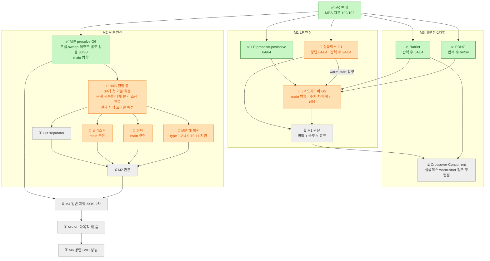

# 12. 로드맵 다이어그램

M3-04a 정적 조사를 완료했다. PDHG·barrier·시작 벡터의 crossover 진입, 배열 순서·변환·할당 실패·환경 복원과 cleanup 내부 상태 배열 설치 경계를 원본 C·ELF로 확인했다. 정적 조사만으로 Rust 동등성을 판정하지 않는다. [조사 기록](m3/crossover_entry_contract.md). 후속 M3-04a-1 오라클은 `work/m3-04a-1`의 `e1f841c`, 위치 `../rsolver-m3-04a-1`에서 검토 완료·병합 대기다.

M2-03c-1은 **부분 완료**다(main 병합). 사용자 결정으로 계약을 바꿨다. Gurobi 원본에서 자연 상태 12 재풀이 2건(비루트·루트)의 입출력·파라미터 복구·basis 입력/header, 합성 5→12 재분류, 상태 3 호출자 `682037`을 각 3회 검증했다. 병합 전 원본 33회 재실행에서 비교 30건이 모두 일치했다. 재풀이 후 VBasis·입력 basis 출처·factor/norm은 M2-03c-2로 분리했다. 상태 10·자연 5→12(정상 산술에서 불가능, 미관측)는 미검증이다. Rust는 변경하지 않았고 동등성은 미검증이다. 상세는 [M2-03c-1](m2/mip_linear_child_trace.md) §10–13.

상태: ✅ 완료 · 🔄 진행 · 🔎 에이전트 검증 완료·병합 대기 · ⏳ 예정 (2026-11-10 기준. main에 병합된 구현과 남은 작업을 표시한다. 세부 기록은 [11_progress.md](11_progress.md), 심플렉스 최신 검증은 [10_porting.md §9.2](10_porting.md))

M1·M2·M3의 세부 작업 번호, 상태와 확인 방법은 [작업 단위 목록](13_work_units.md)에 있다. G1~G6은 기존 검증 관문이다.

M2-03b-1 선형 경로 조사를 완료했다. 루트 캐시 2의 LP 상태 5→12 재분류·즉시 재풀이와 상태 3의 대체 분기 소비를 확인했다. 같은 노드 재등록은 7·8·10이며 대체 분기가 상태 10인 새 자식을 만들 수 있다. 원본 합성 setter·게이트·분기 자격 156회와 오류 주입 4개를 확인했다. 실제 자식 연결·Rust 동등성은 미검증이며 솔버 코드는 유지했다. 다음은 M2-03c-1 선형 호출자·대체 분기 오라클이다. [계약과 결과](m2/mip_unbounded_reclassification.md).

M2-03a 직접 진입 조건 조사는 완료했고 main `ebb35d6`에 병합했다. 순수 선형 LP 무계 입력의 노드 보류와 루트 호출자의 별도 무계 확정을 구분했고, 호출 없는 원본 합성 상태 13개×3회를 확인했다. 직접 상태 11·ray·실제 자식 연결과 Rust 동등성은 미검증이다. 후속 M2-03b-1 결과는 위 기록을 따른다. [상세 결과](m2/mip_unbounded_entry.md).

스프린트 구현 완료는 [동작 동등성 검증 기준](15_sprint_verification.md)의 원본 구간 계약으로 판정한다. 시간·집계 결과만으로 내부 동작 일치를 판정하지 않으며 작업 수행 완료·동등성 판정·전체 관문을 구분한다. 기준 문서와 계약 양식, 시작 지침은 main에 커밋됐다.

24개 번호는 상위 작업이며 실행할 항목은 [1주 스프린트 하위 작업](14_sprint_plan.md)에서 선택한다. 원본 미해독 영역은 조사로 설계를 확정한 뒤 구현 작업을 추가한다. 다음 착수 후보는 M2-03c-1이다. 이 계획과 영역별 설계 보완은 main에 커밋됐다.

새 세션은 [인수인계 안내](handoff/README.md)와 영역별 다음 작업을 읽는다. 같은 저장소의 세 영역 점유와 오프라인 컴퓨터 이동 도구를 추가했다. 컴퓨터 간 자동 동기화는 아직 없고 기존 원격 금지 정책을 유지한다. 설정과 인수인계 문서는 main에 커밋됐다. 브랜치·병합 운영은 [운영 스킬](../.agents/skills/verified-task-branches/SKILL.md)을 따른다.

운영 상태: 기존 선행 변경을 네 커밋으로 분리해 main `09dc65f`에 병합했고, M2-03a는 새 기준선에 재적용해 별도 병합했다. 기존 코드는 스냅숏과 동일하며 Rust 113개·Clippy·Python 653개·세션 도구 3개와 복원 오라클이 통과했다. 운영 스킬·현재 기록은 별도 작업 branch에서 병합하며 종료 시 main만 남긴다. 원래 dirty 상태와 스냅숏 이력은 safety ref로 보존한다. [정리와 검증](m2/baseline_reconciliation.md).

## 현재 작업 범위

- 상세 작업 기록은 `docs/m1/`, `docs/m2/`, `docs/m3/`로 정리했으며 [문서 안내](README.md)에서 찾을 수 있다. 기존 선행 작업은 main에 커밋됐다.

- 현재 MIP 후속은 M2-03 자식 LP 무계, M2-04 시간 제한, M2-05 해 복원으로 구분한다. [작업 단위 목록](13_work_units.md)은 main에 커밋됐다.

- 자식 LP 무계의 직접 확정 조건·필드·호출표를 M2-03a에서 확정했다. 선형 입력은 노드 상태 3으로 보류되고 루트 무계는 호출자가 별도 처리한다. 호출 없는 원본 합성 상태 13개×3회를 확인했으며 ray·직접 상태 11·실제 자식 연결은 실행 미검증이다. Numeric 처리는 유지한다. [조사 기록](m2/mip_unbounded_entry.md)은 main에 병합됐다.

- `AGENTS.md`에 원본 복원 기준과 프로젝트 탐색·검증 경로를 정리했고 main에 커밋했다. 브랜치·병합 스킬을 필수 참조한다.
- B&B, 루트 전파·휴리스틱과 Python MIP 풀이가 main에 있다. presolve 연결과 고정·치환 해 복원은 `13ce2fe`에 커밋됐고 `3e5c9d4`로 main에 병합됐다. 진행 문서도 main에 커밋됐다.
- type 4 flag 1·2와 type 10·11, 빈 축약 모델 처리를 추가했다. type 4 정수 분기는 합성 원본 오라클 1,000개와 일치하고 mas74·mas76 원본 해 검사를 통과했다. 빈 축약 enlight_hard는 최적해 37을 복원했다. type 10·11 대상 두 모델은 Gurobi가 축약 모델에서 구한 해를 원본 공간으로 복원해 검사했다. rsolver는 두 모델에서 30초 내 해를 찾지 못했다. 38개 재측정은 전부 축약 경로, 최적 1·시간 초과 37, 원본 해 검사 22개 통과다. 그 외 미지원 레코드와 복원 검증 실패 시 원본 모델로 우회한다. [작업 기록](m2/mip_recovery_bnb.md). 변경은 main에 커밋·병합됐으며 기존 검증 한계는 유지한다.
- G6의 모델·레코드·PRELIMIT 저장 변화점 및 최종 모델 38/38을 2026-11-09 별도 검증했다. 38개에서 실행되지 않은 하위 풀이는 미구현이며 `3e5c9d4`로 main에 병합됐다. 범위는 [m2_presolve.md](m2/m2_presolve.md)에 있다.

- MIPLIB 38개 첫 측정에서 rsolver 37개 시간 초과, 1개 외부 감시 중단이었다. 이 기준은 시간 제한·복원 경로 후속 전의 저장 결과다. 결과와 도구는 main에 커밋됐다: [기준표](m2/mip_bnb_baseline.md).

- 5초 재측정에서 rsolver 38개가 시간 제한으로 반환됐고, 실제 경로는 축약 26·미지원 레코드 우회 12였다. simplex 반복 시간 제한을 추가했으며 presolve 내부 중단은 남았다. 이 측정은 type 9 지원 전의 저장 결과다. [결과](m2/mip_bnb_5s.md)는 main에 커밋됐다.
